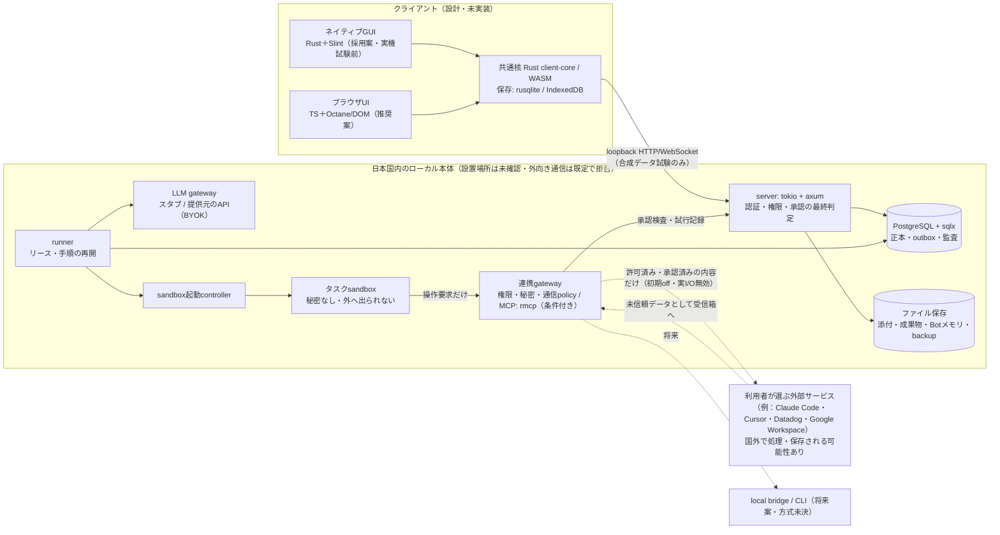
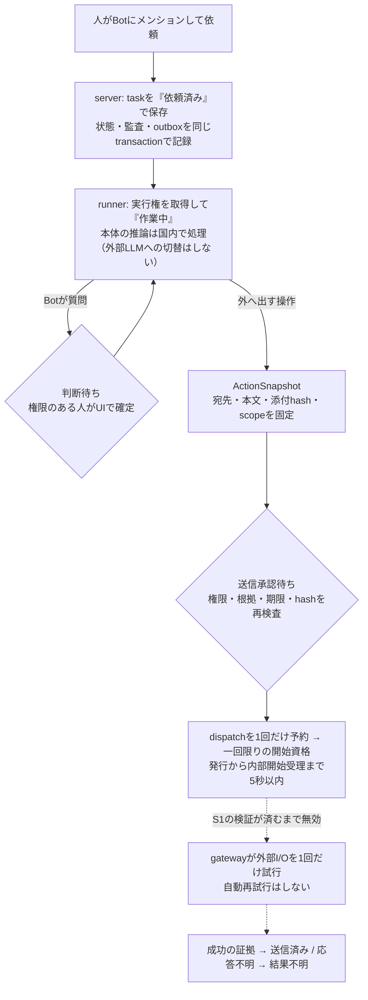

# Pelway 技術アーキテクチャ図（統合版 v0.7 準拠）

状態：統合版 v0.7 本文の図解。設計であり、実装・導入・接続済みではない。実外部I/Oは無効（S1の実装検証待ち）。

根拠（[v0.7本文](technical/v0.7/body/)内のファイル。01-architecture.md、02-stack-comparison.md、03-ai-bot-runtime.md、04-data-api-realtime.md、08-decisions-open.md、10-domestic-only.md、11-integrations.md）。

## 1. 全体構成

根拠：01-architecture.md §ch01-s02・§ch01-s03、02-stack-comparison.md

- 実線は国内の本体。破線は利用者が選んだ場合だけ使う外部経路で、本体の「国外送信なし」の保証に含めない。外部から取り込んだ成果物のPelway側コピーは国内に保存する。
- server・runner・gatewayは最低3つの別プロセス（Linuxコンテナ）。初版は別のメッセージブローカーを使わずDBキュー。
- 初版の必須でないもの：wiki・RAG（pgvector）、常時VM。将来候補：OpenTelemetry。未選定：日本語全文検索（pg_bigm、Tantivy/Lindera）。比較対象：egui。icedとGPUIは読み上げの制約で初版の採用比較から除外。

## 2. 依頼から処理・外部送信までの流れと権限の関門

根拠：01-architecture.md §ch01-s04、03-ai-bot-runtime.md §ch03-s02/s03/s05、04-data-api-realtime.md §ch04-s03

開始受理と外部I/Oは承認とは別に記録する。結果不明の操作は自動で送り直さず、照合したうえで人が判断する。

## 3. 国内と外部の境界

根拠：10-domestic-only.md §ch10-s02〜s04、11-integrations.md

- `core_domestic_policy`（本体）と `integration_grant`（外部連携）の2つのpolicyで分ける。本体のAI処理・保存は国内限定。
- 外部連携は初期off。国外の可能性を表示し、権限のある利用者・管理者が明示的に有効化する。国外というだけで一律禁止はしない。
- 接続するだけでは認証に必要な情報だけを送り、業務データ（会話・添付・repo・log）は同期・索引化・送出しない。業務データは操作ごとの個別承認を経て、許可された内容だけを送る。

## 4. 取消P方針

根拠：03-ai-bot-runtime.md §ch03-s04

- 取消をcommitした以後は、新しい内部開始受理を拒否する。
- すでに受理した1操作は、物理送出前の競合も含めて停止を保証しない。
- 暫定採用した要件変更であり、旧S1を技術的に解消したものではない。

## 5. 未決（08-decisions-open.md U01〜U07）

- U01：S1（取消と送出の競合）の実装と検証。
- U04：連携先の実条件（照会APIの有無、データの地域など）。
- U05：国内設置機材、認証・TLS、鍵と復旧、Slint固定版とrmcpの依存・ライセンス、3OSの日本語入力と読み上げ。
- U06：取消遷移の行単位（採用推奨・未確認）。
- U07：停止要求済み外部runの確認期限と担当。
- LAN公開とローカル認証方式も未決（01-architecture.md §ch01-s05）。
