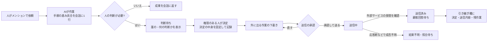
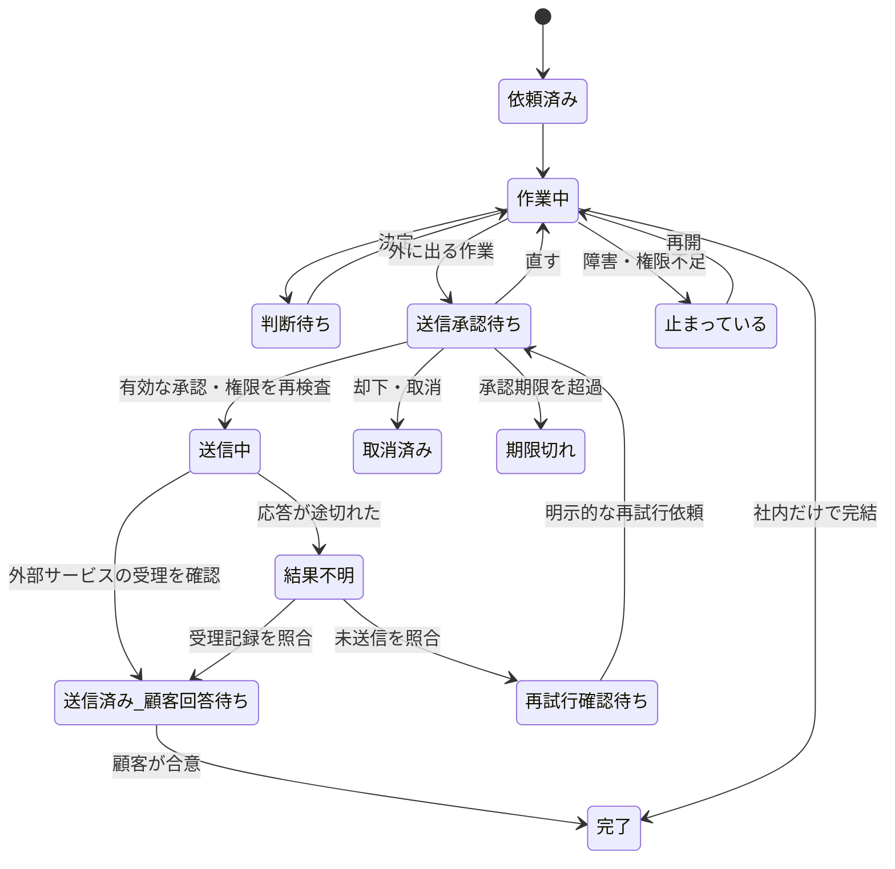

# プロダクト要件（PRD）：対象顧客・ユースケース・MVP

確認日：2026-11-08（日本時間）。担当：プロダクト設計。

この文書は設計案です。記載した機能は実装済みでも提供中でもありません。各項目に次のどれかを付けます。

- **［確定］** これまでの検討で決めた方針。実装完了という意味ではない。
- **［提案］** 設計としての推奨。まだ承認されていない。
- **［仮説］** 顧客の検証で確かめる前提。
- **［未決］** まだ決めていないこと。

例に出てくる「ハル」「ユイ」「リク」は架空のAI社員の名前、「田中」「佐藤」「山本」は架空の人の名前、「B社」は架空の取引先です。画面試作（HTMLモック）で動いて見えるものは、実装済みの機能ではありません。

## 1. 誰のための製品か

| 項目 | 内容 | 区分 |
|---|---|---|
| 広い候補 | IT系のチーム | ［仮説］ |
| 最初に検証する候補 | 広い候補のうち、社外の取引先と案件を進める小さなチーム。依頼、調査、資料作り、取引先への連絡を人とAIで分担する | ［仮説・未検証］ |
| 主な利用者 | 案件を回す担当者（プロジェクトリーダー） | ［仮説・未検証］ |
| 購入を決める人 | 会社の代表、または部門の責任者 | ［仮説・未検証］ |
| 会社の人数 | 現時点では特定の人数に固定しない | ［仮説］ |
| 業種・規模・支払い意思 | 未検証 | ［未決］ |

## 2. 解決したい困りごと

1. 個人がAIと話して得た成果を、チームに説明し直す手間がかかる。［仮説］
2. AIが人の判断を待って止まっていても、誰の何の判断待ちなのかが見えない。［仮説］
3. AIが取引先へのメールなど外に出る作業をするとき、誰が何を承認したのかが後から追えない。［仮説］
4. 担当が変わったときに、決まったことと残っていることが引き継がれない。［仮説］

[競合調査](competitors.md)によると、Context と CircleChat には「チャンネルにAIの同僚がいる」「承認がある」ことの公式な説明があります。なので、この2点だけで差別化はできません。Pelwayは、**依頼から担当決め、実行、判断待ち、承認、送信、引き継ぎまでを一つの仕事の中で切れずに追えること**で差を作ることを狙います。［提案］

## 3. 基本の考え方

| 方針 | 区分 |
|---|---|
| 仕事は会話の中で進める。別の管理画面を見に行かなくても、依頼・判断・承認が会話の流れで済む | ［確定］ |
| AIはAIだとはっきり示す。役割と名前を持つ専門の社員として振る舞う | ［確定］ |
| AIへの新規依頼はメンションを起点にする。依頼されていない会話へ勝手に割り込まない。受付済みの仕事に対する進捗・承認依頼・完了報告の発話条件は別途設計する | 新規依頼の方針は［確定］、通知条件は［未決］ |
| AIの作業画面（机）は自動では開かない。「作業を見る」を押したときに開く | ［確定］ |
| 案件専用のチャンネルは必須にしない。雑談など案件以外のチャンネルは会話だけの画面にする | ［確定］ |
| 社内の決定、取引先への提案の送信、取引先との合意は、それぞれ別の状態として扱う | ［確定］ |
| 社内wikiと外向けQ&Aの自動生成は対象外 | ［確定］ |

## 4. 代表的なユースケース

試作で使った「#案件B」の台本をもとにした例です。［提案］

1. 担当者の田中が「@ハル 納期を1週間延ばす案を2つ作って」と頼む。
2. ハルが作業を始め、会話に「作業中・手順3/7」の1行を出す。押すとハルの作業画面が開く。
3. ハルがA案とB案を出し、「納期と範囲の変更は代表の承認が必要です」と判断待ちに入る。
4. 外出中の山本（代表）がスマホの「今日」画面で判断待ちに気づき、相談を開いて「Aで」と返す。
5. システムは「Aで」という短い返事でも、**A案の中身（本文と添付を含む）をそのまま決定として記録**する。
6. ハルが取引先B社へのメールを下書きする。山本は別の画面で本文を確認し、「直す」か「承認して送る」を選ぶ。
7. 送信後は「B社へ送信済み · 山本 15:20 · 顧客回答待ち」と表示する。社内で決めたことと、取引先がまだ合意していないことを分けて見せる。
8. 担当が佐藤に変わっても、決定、送信した内容、残っていることが引き継ぎ欄に残る。

## 5. 状態の定義

一つの仕事（タスク）が取りうる状態です。［提案］

- 「判断待ち」は、**誰の判断か**と**何を決めるか**を必ず持つ。
- 「送信済み」と「顧客が合意」は別の状態にする。［確定］

## 6. 権限と承認の流れ（仕様の要点）

権限の仕組みそのものは[技術・権限・原価の設計案](technical.md)に任せます。ここでは、使う人から見た流れだけを書きます。

| ルール | 区分 |
|---|---|
| 送信できる人は、会社が付与した権限で決める。決定する権限と送信する権限は分けて持てる | ［確定］ |
| 承認するときは、承認した中身（本文・宛先・添付）を固定する。承認後に中身が変わったら、もう一度承認を求める | ［確定］ |
| 社外に出る操作のうち、事前に決裁された「型」（テンプレート＋宛先範囲＋金額上限＋データ範囲）に一致するものは自動で実行してよい。一致しないもの、検査に引っかかったものは毎回の承認に戻す。取り消せない操作は対象外 | ［確定］（方針。実現方法は［提案］。[ADR 0009](adr/0009-hybrid-approval-with-preapproved-types.md)） |
| 1つの承認を複数の別操作に使い回さない。Pelway内で同じ操作を重複発行しないための状態管理を設計する。外部サービス側での二重送信まで防げるとは保証しない（[技術文書](technical.md)の§6を参照） | ［確定］（方針。実現方法は［提案］） |
| 送信後に応答が途切れ、結果が分からないときは自動で再送しない。「結果不明」として、人に確認を頼む | ［提案］ |
| 実行する直前に、依頼した人・会社・チャンネル・接続アカウントの許可をもう一度確かめる。足りなければ「止まっている」にする | ［提案］ |
| 短い返事（例「Aで」）でも、選ばれた案の中身を決定として残す | ［確定］ |
| 「納期・範囲の変更と顧客への通知は代表の承認が必要」のような会社ごとのルールを引き継ぎに書ける | ［提案］（試作では仮の運用として記載） |
| 誰が・いつ・何を承認したかを記録し、後から見られる | ［提案］ |

## 7. MVPで作るもの・作らないもの

### MVPで作る［提案］

1. 人と複数のAI社員が同じチャンネルにいて、メンションで依頼できる。
2. AI社員を役割付きで迎える（名前、役割、使えるツール、月の利用上限）。
3. 会話の中に、作業の進み具合を1行で出す。押すとAIの作業画面が開く。静止画と手順のログによる表示を候補にする。更新間隔と費用は未検証で、ライブ映像を約束しない。
4. 判断待ちを「今日」画面にまとめる。誰の判断か、何を決めるかを表示する。
5. 決定の記録（中身を固定）、送信承認（直す／承認して送る）、重複発行の抑止と結果不明時の停止。
6. 社内の決定、送信済み（顧客回答待ち）、合意を分けて表示する。
7. 引き継ぎ欄（決定、送信内容、残作業）。
8. スマホでの判断と短い返信（4画面：今日、相談、送信内容の確認、今日に戻る）。
9. 承認と送信の記録（監査ログの最小版）。

### MVPでは作らない［提案］

- 社内wikiと外向けQ&Aの自動生成（そもそも対象外）［確定］
- 「田中に任せる」など、判断そのものを人に委ねる操作
- 条件付きの決定（「〜なら A」）と、AIから出す決定の候補
- 追加の本人確認や高度な送信先制限の管理画面。基本のログイン、会社・チャンネルの権限検査、宛先の確定、送信承認はMVPから外さない
- メールのCC
- 事前に決裁された型による社外操作の自動実行と日次ダイジェスト（[ADR 0009](adr/0009-hybrid-approval-with-preapproved-types.md)。MVPでは社外へ出る操作は毎回承認する）
- 「今日」画面の作り直し、翌朝に矛盾を見つける機能
- テンプレート集のホーム画面

wikiと外向けQ&Aの自動生成は現在の構想から除外します。それ以外の対象外項目は、MVP後に必要性を検証する候補です。

### MVPの受け入れ条件：引き継ぎ・変更・再開［提案］

次の3つの場面で、条件をすべて満たしたらMVPとして合格とします。どれも試作と試用で確かめる前の条件で、競合にない機能だと確認したものではありません。

**A. 担当が変わったとき**（人から人、またはAIからAI）

1. 新しい担当者に閲覧権限がある範囲で、引き継ぎ欄に次の5つがそろっている：決まったこと（決定の中身と、決めた人・時刻）、送った内容（宛先・本文・添付・送信時刻）、今の状態、残っている作業、誰の判断待ちか。
2. まだ決まっていない判断待ちは、決める人が変わったら、新しい決める人に付け替えられる。前の決める人には「担当が変わった」と表示される。
3. 前の担当者がAIだった場合、そのAIの作業途中のファイルや手順の記録に、新しい担当者が権限の範囲でたどり着ける。担当変更だけを理由に機密ファイルや外部アカウントの権限を付与しない。
4. 引き継いだあと、新しい担当者が誰にも聞かずに次の一手を言える（試用で確かめる）。

**B. 承認した内容が変わったとき**

1. 承認後に本文・宛先・添付のどれかが変わったら、前の承認は使えなくなり、「送信承認待ち」に戻る。
2. もう一度承認を求める画面で、前の承認との違いが見える。
3. 承認後に、承認した人の権限が取り消されたら、送信は止まり「止まっている」になる。
4. 承認の期限が切れたら、送信せず、承認者に知らせる（期限の長さは［未決］）。

**C. 失敗した後に再開するとき**

1. AIの実行環境が途中で落ちても、手順のどこまで済んだかと、決定・承認の記録は消えない。
2. 再開すると、済んでいない手順から続ける。済んだ手順のうち、外に出る操作（送信など）はやり直さない。
3. 外に出る操作の結果が分からないときは、自動では再送しない。「結果不明」として人に確認を頼み、外部サービスの記録や人間の確認で結果を照合する。未送信と判断した場合も、実行時の権限・承認の有効性を再確認してから再試行する。照合できない場合は結果不明のまま停止する。
4. LLMが止まったときや、利用上限に届いたときは、「止まっている」とその理由を会話に1行で出し、判断待ちの一覧にも載せる。

## 8. 成功の確かめ方［提案］

目標の数値はまだ決めていません。測っていない数値を実績として書くことはしません。

- 依頼から送信までの間に、人が転記や説明し直しをした回数を、今のやり方と比べる。
- 試用者が「今、誰の判断待ちか」を画面から正しく言えるか。
- 送信した内容が、承認した内容と一致しているか。二重送信が起きないか。
- 担当が変わった後に、新しい担当者が説明なしで続きをできるか。

## 9. 未決事項

| 論点 | 確認すること |
|---|---|
| 最初の顧客 | 業種、チームの人数、AI社員の数、支払い意思 |
| AIどうしの受け渡し | AIからAIへ仕事を渡すときに、人の確認を挟むか |
| 判断待ちの期限 | 期限を過ぎたときに、誰へ知らせるか |
| 取り消し | 送った後の取り消しや訂正を、どう扱うか |
| 複数の承認者 | 2人の承認が必要な場合の流れ |
| 記録の保存期間 | 承認記録をいつまで残すか（技術・セキュリティと一緒に決める） |

## 10. 状態と承認の追加条件［提案］

状態図は代表的な流れです。実行前の却下、取消、承認期限切れも記録し、送信しない状態へ遷移させます。承認直後は「送信中」とし、外部サービスの受理を確認する前に「送信済み」と表示しません。外部サービスが受理したことと、相手への到達・閲覧・合意は区別します。

「Aで」という短い返事は、対象となる相談と案の版が一意の場合にだけ解釈します。複数のA案や変更後の案がある場合は人に選び直してもらい、曖昧なまま決定しません。社内の意思決定は、外部操作の実行承認を兼ねません。

承認者と実行に使うアカウントを別の人にできる条件は、会社の委任規則と接続アカウントの権限で定めます。担当交代だけで承認権限や接続資格を引き継ぎません。

[段階的ロードマップ](roadmap.md)に実装前の検証順序をまとめます。
