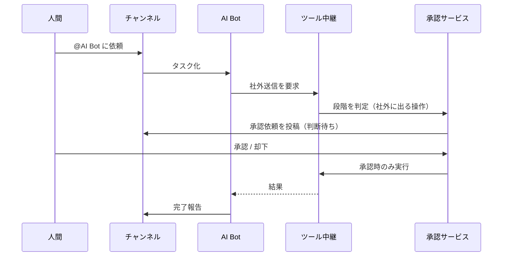

# 技術・権限・障害時の挙動・原価の設計案

- 作成: 2026-11-08（日本時間）、技術・コスト設計担当
- 位置づけ: **提案（未確定）**。確定事項は「前提」の節に書いたものだけです。
- 対象外: 社内wiki・外向けQ&Aの自動生成（現在スコープ外のため、この文書では設計しません）
- **アーキテクチャの現行の正本は [技術仕様 統合版 v0.7](technical/v0.7/README.md) です。** この文書の§2はv0.7を参照する短い説明に置き換えました。§3以降に、v0.7より前の提案（外部LLMの切り替え、外部サンドボックス案など）が歴史的記録として残っている場所では、v0.7を優先してください。

## 1. 前提（決定済み）

- 人間複数と専門AI複数が、同じチャンネルで協業する独立したサービスである。
- AIはAIだと明示する。
- クライアントは、2026-11-08時点の前提では「ブラウザ版から始め、将来Rustのデスクトップアプリを出す」としていました。**v0.7ではこの前提を撤回し、Rust + Slint のネイティブGUIを採用案としていました**（ブラウザUIは推奨案として併記。§2）。この採用案は [ADR 0014](adr/0014-desktop-client-electron.md) で置き換えました。デスクトップアプリは Electron で Web UI（Octane）を包み、D1 から Electron で作ります。Slint は凍結し、D1 の中で廃止します。
- AI Botごとに、VMなどの実行環境と外部ツール連携を持たせる。**現行のv0.7では、実行環境はAI Botごとの常時VMではなく、タスクごとのLinuxコンテナsandbox（秘密なし・外へ出られない）です**（§2）。
- サービス名は Pelway。

## 2. 全体構成

現行のアーキテクチャは、**日本国内のローカルホストで動かす統合版 v0.7** です。かつてこの節にあったクラウド案（Cloudflare Durable Objects によるリアルタイム配信、E2B などの外部サンドボックス、複数のLLM提供元の切り替え、Web TypeScript 先行）は、v0.7 の採用により廃止しました。v0.7の要点は次のとおりです。

- 単一のローカル本体（server: axum、PostgreSQL、タスクごとのLinuxコンテナsandbox、LLMゲートウェイはスタブ/提供元のAPI）
- 本体AIは提供元のAPIをLLMゲートウェイ経由で使う。MVPはテナントが自分で契約した提供元（BYOK、契約者の責任による国内完結の例外）だけで、提供元の自動切替はしない（[ADR 0008](adr/0008-llm-provider-and-byok.md)）。外部連携は別の境界で、初期off
- クライアントは Rust + Slint のネイティブGUI（ブラウザUIは推奨案として併記）としていました。[ADR 0014](adr/0014-desktop-client-electron.md) で、Electron で Web UI を包むデスクトップアプリに置き換え、D1 から Electron で作ります

詳細と根拠:

- 正本: [技術仕様 統合版 v0.7](technical/v0.7/README.md)（本文は `docs/technical/v0.7/body/` の01〜13）
- 本番配置の雛形（Compose＋リバースプロキシ＋systemdタイマーの単一ホスト、国内ホスティング前提）: [ADR 0012](adr/0012-production-topology-single-host.md)
- 図解: [技術アーキテクチャ図（v0.7準拠）](architecture-v0.7.md)
- 原価の計算（§9）は、モデル単価と使用量の仮定を入れ替えればv0.7構成でも使える形で残しています

## 3. 権限と承認（提案）

AI Botの操作を4段階に分け、段階ごとに既定の扱いを決めます。会社の管理者が、AI Botごとに厳しくする方向へ変えられるようにします。

| 段階 | 例 | 既定の扱い |
|---|---|---|
| 読む | チャンネルやファイルを読む、Webを検索する | 許可済みのデータ範囲・送信先だけ、自動で実行 |
| 社内で戻せる書き込み | 下書きの作成、自分の作業場のファイル変更 | 許可された作業場だけで自動実行し、記録する |
| 社外に出る操作 | メールやメッセージの送信、外部サービスへの投稿 | **毎回、人の承認が必要**。ただし事前に決裁された型に一致するものは自動実行を認める（[ADR 0009](adr/0009-hybrid-approval-with-preapproved-types.md)） |
| 戻せない操作 | 削除、支払い、権限の変更 | **毎回承認が必要で、承認できる人を限定する** |

- 承認依頼には、実際に送る内容をそのまま表示します。承認後に内容が変わったら、承認をやり直します。
- 社外に出る操作のうち、**事前に決裁された型に一致するものは自動実行してよい**（[ADR 0009](adr/0009-hybrid-approval-with-preapproved-types.md)）。型は、生成ルールとしてのテンプレート、宛先範囲、金額上限、データ範囲の組で、版管理し、型の変更は内容の変更と同様に再決裁を要します。実行記録には根拠となった型の版を結び付けます。型の決裁者はADR 0002と同じくカードの作成時に指定した承認者とし、型にも期限を設けて、期限が切れたら自動実行を止めます。この仕組みはADR 0004の段階宣言の上に乗る拡張で、読む操作と社内で戻せる書き込みは従来どおり、戻せない操作（削除・支払い・権限の変更）は対象外として毎回の承認と承認者の限定を続けます。
- 型への一致判定は、機械的検査（宛先ドメイン、金額、添付の有無、初めての宛先か）を先に行い、意味的な逸脱（過剰な約束、金額や契約条件への言及）の検査にモデル審査を使います。モデルは承認者ではなく番人で、どちらかの検査に引っかかれば自動実行せず毎回の承認へ落とします（fail-closed）。自動実行は全件を記録し、日次ダイジェストで承認者がまとめて確認でき、型ごとに即時停止できます。メールやWebhookなど外部起点の実行は一段厳しくし、外部の文章に宛先や内容を決めさせません。
- 承認されなかった操作や期限切れの操作は、AIが自動で言い換えて再申請しません。
- AI Botへの役割設定と外部アカウントの権限は分けます。AIを作成した人の権限を、すべての依頼に自動で使いません。会社の方針、依頼者の権限、承認者の権限、チャンネルの許可、接続アカウントの権限を満たす範囲に操作を限定します。委任の具体的な設定方式は未決です。
- それとは別に、**実行の直前に**次の許可をすべて確かめます。1つでも欠けていれば実行しません。承認したあとに許可が変わった場合も同じです。
  1. 依頼者：その操作を依頼する権限を持っているか
  2. 会社：会社の方針で、その種類の操作が許されているか
  3. チャンネル：そのチャンネルで、その操作が許されているか
  4. 承認者：その操作の承認権限を現在も持ち、有効な承認があるか
  5. 接続アカウント：使う外部アカウントの権限の範囲に入っていて、接続が取り消されていないか

## 4. セキュリティ（提案）

- **会社ごとの分離**: データは会社IDで分け、実行環境は会社とAI Botごとに別にします。実行環境を会社間で使い回しません。
- **API鍵を実行環境に置かない方針**: 外部ツールの認証情報は保管庫に置き、ツール中継が呼び出すときにだけ付けます。AIが乗っ取られても、鍵そのものは漏れにくくなります。
- **外への通信を絞る**: 実行環境から外への通信は、許可したあて先だけにする設定を既定にします。アプリ側の規則（送信先制御・taint、#182）に加えて、ホスト側のファイアウォールでも担保します（下の「実行環境のegress制限のホスト側担保」）。
- **外から来た文章は命令として扱わない**: Webページ、メール、ツールの結果に書かれた指示で、送信や削除が起きないようにします。モデルへの指示だけに依存せず、ツール中継で権限と承認対象を検査します。読むだけの操作でも、読み出し範囲と外部への送信先を制限します。承認を受けても権限外の操作は実行しません。
- **監査ログ**: 誰が（人間かAIか）、いつ、何を、誰の承認で実行したかを、追記のみのログに残します。
- **AIの明示**: メッセージのデータに「人間かAIか」を必ず持たせ、画面に表示します。
- **データの保存場所**: LLM各社の推論地域の指定は、提供元ごとに違います。例えば Anthropic は、米国内だけで推論する指定をすると料金が1.1倍になります（[Anthropic 料金ページ](https://docs.anthropic.com/en/docs/about-claude/pricing)、2026-11-08確認）。**日本国内に限った推論が選べるかは未確認です。**

### 実行環境のegress制限のホスト側担保（提案）

アプリ側の送信先の規則（#182）は、ゲートウェイやツール中継というアプリ層の検査です。アプリに不具合があればすり抜けるため、同じ制限をホスト側のファイアウォールでも担保し、多層防御とします。出典は Rakazo の `infra/compose/restrict-computer-egress.sh` と同 `restrict-computer-egress.smoke.sh`（elie222/rakazo）で、ここではその設計を Pelway の構成（タスクごとのLinuxコンテナsandbox）へ翻案して採用します。

**注記（v0.7 の既定拒否との関係。後続 #389 との分担）**:

- 本節の方式の runtime 前提は Linux Docker Engine（iptables バックエンド）です。v0.7 の第一候補である rootless Podman（pasta / slirp4netns）では、パケットがホストの iptables に届かないため、この規則は適用されません。
- v0.7 が定める sandbox の外向き通信の**既定拒否**（許可した出口だけを通す。rootless Podman でも効くこと）は、後続の #389 で実現します。#389 が入るまで、ホスト側の担保は本節のブロックリスト方式（非公開あて先のみを落とす）です。

**方式（ブロックリストによるホスト側の担保）**:

- 対象は、Linux Docker Engine（iptables バックエンド）の `DOCKER-USER` チェーンと `INPUT` チェーンです。サンドボックスのコンテナが繋がるブリッジに決定論的な接頭辞を持つ名前を割り当て、その接頭辞を鍵に規則を挿入します。Docker が動的に割り当てるサブネットには鍵付けないため、コンテナの増減・ネットワーク再作成・サブネットの再利用でファイアウォールを更新する必要がありません。
- ホスト側は**許可先のリスト（allowlist）を管理しません**。代わりに非公開あて先の総ざらいの**ブロックリスト**を落とします: RFC1918 / CGNAT / link-local（クラウドのメタデータサービス `169.254.169.254` を含む）/ マルチキャスト / 予約領域のIPv4各ブロックと、IPv6では loopback / ULA / link-local / マルチキャストです。クラウドメタデータは認証情報の窃取経路として真っ先に閉じます。
- ホスト自身（Dockerデーモン・サーバープロセス）への接続も、サンドボックスからは拒否します（`INPUT` のdrop）。ホストからサンドボックスへ自分で開いた接続（制御・画面の配信）の応答は通すため、`ESTABLISHED,RELATED` の許可をdropより上に置きます。
- 同じブリッジ内の peer（スーパーバイザや画面プロキシ）との通信は、ブリッジをまたがない通信としてdropの前に`RETURN`で通します。
- 適用スクリプトは冪等にします（既存規則の前置一致で判定し、重複を削除する。途中失敗で担保が一時的に外れないよう、先に新しい規則を挿入してから古い複製を消す）。再起動後も担保を続けるため、systemd の oneshot ユニットで再適用を永続化します。
- iptables が無い（nftables バックエンドのみ等）のに成功を装わない、IPv6 が有効なのに ip6tables で same 規則を置けない、といった場合は失敗として通知します（fail-closed）。

**許可先の管理方法**:

- **許可先の一覧はアプリ側の送信先制御の規則だけが持ち、ホスト側では管理しない**。ホスト側の規則は上のブロックリストに固定し、運用者による個別許可の追加は行いません。理由は2つで、(1) ホスト側の許可リストはアプリ側の規則と二重管理になってずれの元になる、(2) ブロックリストは「公開インターネットには出られるが、非公開ネットワークとホスト・メタデータには出られない」という不変の性質なので、許可先の変更のたびに触る必要がない、ためです。

**smoke テストでの継続検証**（観点の定義。ランタイムのテスト分類全体は #183 で整理する）:

1. **オフラインの規則検査**: iptables をスタブに置き換え、root や Docker デーモン無しで、適用スクリプトが出力する規則を検査する。非公開IPv4各ブロックとIPv6各ブロックのdropがすべて並ぶこと、同ブリッジのRETURNがdropより上に来ること、INPUTのESTABLISHED許可がdropより上に来ること、適用が冪等であること（2回実行で規則が増えないこと）、適用の途中失敗時に既存の担保が失われないこと。
2. **実機プローブ**: 実際にホストで規則を適用したあと、サンドボックスから (a) `169.254.169.254`（メタデータ）とホストのアドレスへの接続が拒否されること、(b) 同ブリッジのpeerと、公開あて先への通信は遮断されないことを確認する。
3. これらのsmokeは、ファイアウォール規則や適用スクリプトを変えるPRで必ず走るようにします（#183 のテスト分類の「ホストの安全装置」枠に接続）。

**アプリ側の規則（#182）との関係（矛盾しないことの明記）**:

- 層の分担: #182 はゲートウェイ・ツール中継での送信先判定（registrable domain 単位の同一性判定、taint の格上げ、審査に渡す情報の制限）という**アプリ層の許可の規則**です。本節のホスト側の規則は**ネットワーク層の境界**で、アプリが誰を許可したとしても、非公開ネットワーク・ホスト・メタデータへの通信は物理的に出られなくします。二つの層は重なって守る関係（多層防御）であって、許可先の定義が食い違う関係ではありません。ホスト側のブロックリストは #182 の許可先の定義に影響を与えず、#182 の許可先に非公開あて先が含まれることも（社内への送信は別の承認経路で扱う限り）ありません。
- この多層により、アプリ側の実装の不具合や将来の変更で送信先の検査が壊れても、非公開ネットワークへの漏洩はホスト側で止まります。

**未決事項**:

- 提供元が外部（E2B 等）のサンドボックスでは、ホスト側のファイアウォールは Pelway の管理外にあります。この場合は (a) 提供元のegress制御機能の有無の確認、(b) 提供元を通さない構成（ローカル実行）への限定、のどちらかを提供元ごとに決める必要があります（未決。v0.7 はローカル構成のため、Linux Docker Engine の構成では MVPでも本節のホスト側担保がそのまま効きます。v0.7 の第一候補の rootless Podman では適用されない点は、上の注記のとおり #389 で扱います）。

### 審査系AIの実行環境の隔離原則（提案）

Pelway の審査系AI（ハイブリッド承認の番人、承認の審査）は、被審査側のプロジェクト指示・スキル・記憶が審査の前提を書き換える経路を断つため、Bot の作業環境とは別の**審査専用の読み取り中心の環境**で動かします。出典は Buzz（block/buzz-app）の `docs/agent-protection.md` が採る隔離構造（セキュリティレビューを読み取り専用の別ホームで実行し、レビュー側ではプロジェクト指示・スキル・メモリを無効化する）で、ここではそれを Pelway の審査系（番人・承認審査）へ翻案して採用します。この原則は、taint と送信先制御（#182）の規則のうち「審査に渡す情報の制限」を審査側から見て固定するものです。

**原則**:

- **審査専用の環境**: 審査系AIのプロセスは、被審査タスクの作業sandbox・ホームディレクトリを共有せず、審査のためだけに用意した環境で起動します。作業環境の環境変数・資格情報・会話履歴・成果物は、審査環境からは参照できません（被審査タスクの作業領域に審査環境が触れるのは、審査対象として明示的に渡された入力だけです）。
- **被審査側の文脈を持ち込まない**: 審査環境では、被審査側のBotに効いているプロジェクト指示・スキル・記憶（永続メモリ）を一切読み込みません。これらは被審査側で組み立てられた前提であり、審査の判定基準を書き換える入力になり得るためです。審査系AI自身の指示（判定の質問と結果の形式）だけを審査環境に置きます。
- **読み取り中心・ツールなし**: 審査系AIは外部への通信・副作用の手段を持たず、LLMゲートウェイ経由の推論だけを行います（ツールなし。Buzz の tool-free review worker と同じ形）。審査対象の情報はPelway側から渡し、審査系AIが自ら取りに行く経路をなくします。

**持ち込む情報（この列挙がすべてです）**:

1. 審査対象の正規化済み入力: gatewayが正規化した操作名・送信アカウント・宛先・本文・添付の内容hash・参照版・許可scope・integration版（`ActionSnapshot` 相当）と、当てはめる型の版（テンプレート・宛先範囲・金額上限・データ範囲）。外部から来た文章は、Pelwayの中で組み立てられた正規化済みの内容だけを渡し、外部の文面をそのまま判定の入力にしません（v0.7 本文03の型一致判定と同じ規則）。
2. 判定の質問と結果のスキーマ: 機械的に定義された質問と型付きの出力（合格/不合格とその根拠となった入力の位置）。審査系AIが自由文で承認・却下を述べる形にはしません。
3. 審査モデルの呼出に必要な最小限の資格情報: 保管庫（資格情報broker）から審査プロセスにだけ渡します。作業環境の資格情報は使いません。
4. 監査記録のための識別子: task・operation・型の版のIDと時刻。監査ログへの追記は審査系AI自身は行わず、serverが審査の入出力を記録します。

**動作と失敗時の挙動（fail-closed）**:

- 審査環境が用意できない、資格情報が無効、審査モデルの呼出に失敗した、審査が期限までに結果を返さない場合は、審査不合格として扱います。型一致の自動実行は行わず、毎回の承認（送信承認待ち）へ落とします。審査を省略して自動実行する経路は作りません。
- 審査系AIの拒否理由は被審査側のBotには渡しません（審査の判定基準が被審査側へ漏れて、次回の審査をすり抜ける最適化を許さないためです）。拒否理由は人間（承認者・監査）への表示と監査ログにだけ残します。

**適用範囲**:

- **番人（#189）**: ハイブリッド承認（ADR 0009）の機械的検査の後のモデル審査（番人）は、この隔離環境で動かします。番人の方式（typed judge か LLM ジャッジか）は #189 の評価で決まりますが、どちらの方式でもこの隔離原則は同じ適用です（方式に依らない原則です）。
- **承認の審査**: 個別snapshot承認の判断を補助するためにモデルを使うときも、同じ隔離環境と持ち込む情報の制限を適用します。承認者への差分表示に審査結果を添える形で使い、審査結果が承認を代替することはありません（承認するのは人間です）。

**v0.7 本文03・#182 との関係（矛盾しないことの明記）**:

- v0.7 本文03「隔離と秘密」はBotの作業sandboxの隔離を、本節は審査系AIの隔離を定めます。作業sandboxの規則（非root・read-onlyルート・秘密はbrokerに置く）を審査環境にも適用した上で、本節の追加の規則（被審査側の文脈を持ち込まない、持ち込む情報の列挙）が上に乗ります。本節は本文03の既存の規則（秘密をBot・LLM・成果物・ログへ出さない、型一致の判定はPelwayの中で組み立てられた内容に対して行う）と矛盾しません。
- #182 が定める「審査モデルには外部コンテンツを見せず、必要最小限の情報だけを渡す」規則を、審査実行環境の側からも固定します。#182 のアプリ層の規則と本節の隔離は、同じ「審査に渡る情報」を両側から制限する関係です。

**未決事項**:

- 審査環境の具体的な実装（別コンテナか別ホームか、審査環境の起動・破棄の単位）は実装時の別Issueで扱います。本節は原則のみを定めます。
- 番人の方式（#189）の結論しだいで、型付き出力のスキーマの具体形は変わります。

### ツール実行系の堅牢化チェックリスト（提案）

Pelway のツール実行系（MCP サーバー、ツール中継の実行部。gateway がツール呼び出しのために立ち上げる外部プロセスを伴う呼び出しすべてで、[技術03「隔離と秘密」](technical/v0.7/body/03-ai-bot-runtime.md#ch03-s07)が挙げる CLI・hook・API・webhook を含む）について、プロセスの後始末・出力の上限・キャンセルの正しさを、実装とレビューの観点として固定します。出典は Buzz（block/buzz）の `VISION_AGENT.md`（buzz-dev-mcp。2026-11-17 確認）の設計原則（エフェメラルなプロセス、すべての終了経路でプロセスグループごと kill、出力サイズの上限、キャンセル経路ごとの回帰テスト）で、ここではそれを Pelway の構成へ翻案して採用します。

**対象と対象外**:

- 対象: ツール中継（gateway）がツール呼び出しのために起動・管理するプロセスと、その出力・履歴・キャンセルの扱い。MCP サーバー（stdio の子プロセス）を含む
- 対象外: サンドボックス基盤そのもの（supervisor の分離と提供元インターフェース。#184）。ツール実行系の実装そのもの（この節は観点の定義であり、実装は個別のIssueで行う）

**チェックリスト**（実装とレビューはこの4領域を観点に使う）:

#### プロセスの終了保証

- ツール実行のプロセスはエフェメラルにする: 呼び出し（またはセッション）ごとに起動し、終了したプロセスを次の呼び出しに再利用しない
- すべての終了経路（正常終了・異常終了・タイムアウト・キャンセル・パニック・親プロセスの停止）で、プロセスグループごと kill する。直属の子だけ kill して孫を残さない（タイムアウトではプロセスツリーごと kill する）
- 終了経路を辿ったあと子孫プロセスが残っていないことを確認できる。終了処理自体が失敗したら、成功扱いにせず記録する

#### 出力・履歴の上限

- ツールの出力（stdout・stderr・ファイルの読取結果）にサイズ上限を設ける。超過時は切り詰め、切り詰めた事実と元のサイズを結果に添える（黙って成功扱いにしない）
- セッション履歴と実行ログに件数・サイズの上限を設ける（Buzz の bounded output / bounded history と同じ）
- プロセスの寿命に上限を設ける（放置されたプロセスが生存し続けない）
- 上限に達した呼び出しは失敗として扱い、他の呼び出しやセッションへ伝播させない（有界な失敗として gracefully に劣化させる）

#### タイムアウトとキャンセルの扱い

- キャンセル経路（利用者の取消・承認の失効・タスクの停止・セッションの終了・タイムアウト）ごとに挙動を定め、どの経路でもキャンセル後の結果を成功として確定しない
- キャンセルのすべての経路で、履歴と状態記録の整合性を保つ（Buzz の「History validity is maintained on every cancellation path」の翻案）
- HTTP client・proxy 等による自動再試行を禁止する（[技術03「固定承認と外部副作用」](technical/v0.7/body/03-ai-bot-runtime.md#ch03-s05)の手順8と同じ規則）
- タイムアウトは結果の確定ではなく、結果不明として扱う（[技術03「9状態と遷移」](technical/v0.7/body/03-ai-bot-runtime.md#ch03-s03)の結果不明の規則に接続）
- キャンセル経路ごとに回帰テストを置く（Buzz の「Key safety properties have regression tests」の翻案。下の対応表）

#### 作業ディレクトリの解決規則

- ファイル編集・パス参照は、タスク（呼び出し）に割り当てた作業ディレクトリを基準に解決する（親プロセスの cwd や絶対パスの表記をそのまま信用しない。Buzz の「File edits resolve against the working directory」の翻案）
- 作業ディレクトリの外への書き込みを行わない（技術03「隔離と秘密」の「task用の書込領域のみ」と同じ）

**テスト観点と #183 の分類との対応**:

各領域に対応するテスト観点を、#183（ランタイムのリスク別テスト分類）の分類に対応付けます。#183 は未着手のため、ここでは #183 の本文が挙げるリスク単位（Rakazo 由来）に対応を付けておき、#183 が分類を固めたらこの表をその分類へ揃えます:

| 領域 | #183 の分類でのテスト観点（リスク単位） | 確認すること |
|---|---|---|
| プロセスの終了保証 | ループガード / コンピュータのチェックポイント再開 | 終了しないプロセスが実行資源を占有しない。残留プロセスが再開後の実行に干渉しない |
| 出力・履歴の上限 | ログイン情報の秘匿 / ループガード | 切り詰めの境界がログイン情報を露出しない。無限出力で資源が枯渇しない |
| タイムアウトとキャンセルの扱い | 効果の冪等性 / コンピュータのチェックポイント再開 | キャンセル・タイムアウト後の再実行を2回目の副作用として扱う。キャンセル経路ごとに履歴の整合性が保たれる |
| 作業ディレクトリの解決規則 | 秘密の出所 / 読み取り専用時の承認 | 作業領域の外の秘密（資格情報）を読み込まない。作業領域の外への書き込みを拒否する |

**技術03・#184 との関係（矛盾しないことの明記）**:

- 技術03「隔離と秘密」は sandbox（実行環境）の隔離と秘密の扱いを、本節はツール中継が立ち上げるプロセスの後始末・上限・キャンセルを定めます。sandbox 側のリソース上限（CPU・メモリ・PID・時間）と本節の出力・履歴・寿命の上限は重なって守る関係であって、矛盾しません
- #184 が扱う supervisor の分離と提供元インターフェースは、このチェックリストの対象外です。本節の観点は提供元の種類に依らず（sandbox 内でもホスト直でも）、ツール実行のプロセス管理に適用します

### AI発言の出口検査（reply-guard）（提案）

AI社員（Bot）が生成した発言の本文は、チャンネルへ保存・配信する前にサーバー側の発言パイプラインで検査し、異常な内容を検出したら止めます。出典は CircleChat（tashfeenahmed/circlechat）の reply-guard（サーバー側で、エラー出力・ツール呼び出しのJSON・トークン漏れ・繰り返しを含む返信を拒否する仕組み。[docs/competitors/circlechat.md](competitors/circlechat.md)「返信の検査」）で、ここではその分類を Pelway の発言モデル（Botの発言はサーバーを通じてチャンネルへ配信される）へ翻案して採用します。この節は検査の対象・検出時の扱い・適用範囲の規則のみを定め、実装と網羅的なパターン辞書は対象外です。

**検査の位置（発言パイプラインでの出口）**:

- 検査はサーバー側で、Botの実行環境から受け取った発言本文をチャンネルへ保存・配信する前に必ず通します。Bot側（エンジン・クライアント）の検査に依存せず、検査を迂回する経路は作りません。Botが乗っ取られても、異常な発言はチャンネルに出ません。
- 対象は Bot の発言の本文と、添付のメタ情報と添付の内容です。人間の発言には適用しません。
- 添付の内容は、本文と同じ3分類の対象パターンで検査します。内容を取り出せない添付（壊れている・形式が読めない等）と大きすぎる添付は、検査を省略して通さず、投稿を止めます（fail-closed）。
- **暗号化された添付**: 暗号化された添付は内容を検査できません。注記付き（内容の検査を省略した旨を添えて）通せるのは、人がアップロードした添付だけです。Bot が投稿する暗号化された添付は、人のアップロードしたファイルを内容を変えずに転送するもので、hashが一致するときだけ通します。それ以外の暗号化された添付（Bot が新しく作ったもの・改変したもの）は、検査を回避して秘密を運ぶ経路になるため、投稿を止めます。

**対象パターン（3分類）**:

1. **漏洩系**（外部に出してはいけない内容）:
   - 例外のスタックトレース（Python のトレースバック等）
   - LLMゲートウェイ・提供元のエラー文のエコー（HTTPステータス行・提供元のエラー文字列の貼り付け）
   - ツール呼び出しのJSON・内部タグ（tool_use・actions 等の内部形式）の漏出と、ツール呼び出し構文の剥き出し
   - 資格情報らしき文字列（Bearerトークン、API鍵・トークン・環境変数の値の形状）
   - 資格情報を人に要求する文（チャットやコメントの中での秘密の要求）
   - 実行スクリプトの貼り付け（curl や API を叩くスクリプト。資格情報や内部の宛先を含み得るため、緩和できません）
   - 内部制御用のセンチネル・タグ（思考・メタデータ等の内部タグ、ランタイムの内部通知文）の漏出
2. **形式の異常系**（発言として成立していない）:
   - 空・空白のみの本文
   - 文字化け（複数の文字体系が混在した崩れた出力）
   - 内部向けのメタ発言（思考の漏出した冒頭、投稿行為そのものの描写、ツール結果の第三者視点のナレーション）
   - 裏付けのない成果の主張（添付の無い「添付しました」、URLの無い「デプロイしました」）
   - コード・差分・ログの大量貼り付け（発言全体がダンプで、発言として成立していないもの。仕事で扱うコードやログは、引用としては正当なため、適用範囲の節のとおり緩和できます）
3. **暴走系**:
   - 同一内容の繰り返し（同一の行・文がしきい値以上並ぶ暴走）
   - 短時間での連続投稿（回数上限を超えるループの暴走）

**検出時の扱い**:

- **投稿を止める**: 検出した発言はチャンネルへ保存・配信しません（fail-closed）。CircleChat がトークン漏れについて採る「秘密だけマスクして通す（scrub-and-post）」は行いません。部分マスクの取りこぼしで秘密が本文に残る危険を避けるためです。秘密を含んだ発言は、Botが書き直せば自然に消える内容です。
- **AI へは汎用の差し戻し**: 検出の詳細（どの分類のどのパターンが、発言のどこに一致したか、元の本文）を Bot へは返しません。次のターンに渡すのは「この発言は投稿できなかった。発言を書き直す」旨の汎用の差し戻しだけです。CircleChat が却下のたびに Bot へ返す教示的な手がかり（teaching hint）は採りません。検出パターンを学んだすり抜け（どの書き方なら検査を通るかの試行）を許さないためです。
- **人へ知らせる**: 検出の事実と詳細（分類・パターン・一致位置・元の本文）は、人間の画面（チャンネルの管理者・会社の管理者向けの通知）にだけ出します。
- **監査ログ**: 監査ログには元の文を残しません。理由コード（分類とパターンをコード化したもの）と、止めた発言の本文と添付の内容hashだけを、追記のみの監査ログに残します（検出の事実と対象は理由コードとhashで追跡でき、止めた発言の内容がログ経由で外に漏れないためです。CircleChat も拒否した返信を行として監査に残します）。時刻・チャンネル・Bot などの運用の情報をいつ・どこまで監査ログに足すかは、別の Issue で仕様を決めてから入れます。

**正当な発言を誤って止めないための扱い（チャンネルと役割による適用範囲）**:

- **パターンは保守的に**: 各パターンは「発言全体がその異常である」（発言そのものがスタックトレースである、等）を検出する、先頭固定の狭い条件に限ります。ただし、先頭固定・「発言全体がその異常である」の各条件は、漏洩系には適用しません。漏洩系のうち誤検出の少ないパターン（資格情報らしき文字列・実行スクリプトの貼り付け・内部制御用のセンチネル・タグ等）は、発言の文中一致でも検出します（Bot が通常の文中に秘密を埋め込んだ発言を、発言全体の一致だけを見る検査がすり抜けるのを防ぐためです。添付の内容も本文と同じ3分類で検査するため、同じ規則です）。文中で例外・エラー・コードに言及するだけの正当な発言（「デプロイが HTTP 500 で失敗したので再試行します」等）は通します。
- **コードやログを扱う仕事**: フェンスで囲んだ短いコード片やログの引用は、形式の異常系のコード・差分・ログの大量貼り付けの検査から外します（漏洩系・暴走系の検査は免除しません。フェンスの中に秘密を書くだけで検査を迂回できる読みを排除するためです）。コードやログを扱う仕事（開発・障害対応等）のチャンネルでは、形式の異常系のうちコード・差分・ログの大量貼り付けの観点だけを、チャンネル設定として緩和・除外できます。
- **緩和の権限**: 緩和・除外は人間（チャンネルの管理者）だけが設定でき、Bot・AI側からは変更できません。漏洩系（スタックトレース、エラー文、ツール呼び出しのJSON、資格情報らしき文字列、資格情報の要求、実行スクリプトの貼り付け、内部制御用のセンチネル・タグ）と暴走系は、すべてのチャンネル・役割で常時適用し、緩和・除外の対象にしません。チャンネルと役割による適用範囲の変更は、形式の異常系の一部（コード・差分・ログの大量貼り付けの観点）にだけ効きます。

**#183・v0.7 本文03・#192 との関係（矛盾しないことの明記）**:

- #183 のテスト分類（秘密の漏洩系）のうち発言本文を経由する観点は、この出口検査の実装・テストで検証します（実装 Issue は #183 の分類に接続します）。
- v0.7 本文03「隔離と秘密」は秘密を Bot の作業環境に置かない入口側の防止で、本節は漏れた場合の出口側の検査です。二つは重なって守る関係で、矛盾しません。
- #192（審査の却下理由をAIに返さない規則）と同じ規則形状です。#192 が定めるのは審査・番人の却下理由の扱いで、本節が定めるのは出口検査の検出結果の扱いです。扱う対象は違いますが、「詳細は人間の画面のみ、AI へは汎用の通知のみ」で同一の規則であり、矛盾しません。

**未決事項**:

- 各パターンの具体的な条件・しきい値（繰り返しの回数、コード貼り付けの行数、連続投稿の回数と時間窓）と、検出の方式（正規表現だけか、モデル判定を併用するか）は実装の Issue で決めます。
- 暗号化添付の「hashが一致」の比較対象（人のアップロード時に保存した hash と、Bot が転送する添付の内容hashを比較する等）は実装の Issue で決めます。
- 人への通知の宛先（チャンネルの管理者・会社の管理者のどちらを既定にするか）は実装時に決めます。

## 5. LLMの選び方と切り替え（提案）

- 作業の重さでモデルを分けます。例えば、振り分けや要約は小さいモデル、本作業は中くらいのモデル、難しい作業だけ上位のモデルを使います。
- 同じ内容を繰り返し送る部分（役割の指示や作業の経緯）は、各社のプロンプトキャッシュを使います。キャッシュから読んだ分は、通常の入力単価の1割以下になります（Anthropic、OpenAI の料金ページ。単価は§9）。
- 1社に依存しないよう、LLMゲートウェイで複数社を切り替えられるようにします。ただし、モデルごとに挙動が違うので、切り替えるたびに評価が必要です。

## 6. 障害時の挙動（提案）

| 起きること | 挙動 |
|---|---|
| LLMの提供元が落ちる、または遅い | LLMゲートウェイが、会社で事前に許可され、保存地域・データ利用条件・ツール権限・予算の条件を満たす別モデルへ切り替える案です。条件を満たす切り替え先がなければ、タスクを「止まっている」にしてチャンネルに理由を出します。黙って失敗させません |
| 実行環境が途中で止まる | タスクは最後に記録した段階から再開します。社外に出る操作と戻せない操作は、実行したかどうかを先に確かめてから再開します。確かめられない場合は自動で再実行せず、「結果不明」にして人の確認を待ちます（下の「二重実行への対策」） |
| 承認の待ち中に期限が切れる | 操作は実行せず「期限切れ」にします。AIが自動で再申請はしません |
| 型による自動実行の判定に失敗する、または型が停止・期限切れのとき | 自動実行をせず、毎回の承認へ落とします（fail-closed）。実行済みの記録と日次ダイジェストは残します（[ADR 0009](adr/0009-hybrid-approval-with-preapproved-types.md)） |
| 承認後、実行前に権限が取り消される | 実行の直前に権限をもう一度確認し、取り消されていれば実行しません |
| 外部ツールが失敗する | 読むだけの操作は回数を決めて再試行します。書き込みは再試行の前に、すでに成功していないかを確認します |
| 予算の上限に届く | 新しいタスクを受け付けず、管理者に知らせます。実行中のタスクは安全に停止できる箇所で止めます。実行前の費用予約と並列タスクの残予算を管理し、新たな有料処理は予約可能な範囲だけ許可します。遅延計上や停止できない外部処理により厳密な上限を保証できない場合、その条件を表示します |
| リアルタイム配信が切れる | クライアントは再接続し、最後に受け取った発言の続きから取り直します。発言の順番はチャンネル単位でサーバーが決めます |

#### 二重実行への対策（提案）

操作IDだけでは、二重実行を完全には防げません。次の3つを分けて扱います。

1. **Pelway側の操作ID**：社外に出る操作と戻せない操作に、1回限りのIDを付け、一意制約と状態遷移の排他制御で重複発行を抑止する設計を提案します。IDを付けるだけでは不十分で、外部サービスが受け取ったかどうかまでは分かりません。
2. **外部サービス側の冪等性**：同じリクエストを2回受けても1回分として扱う仕組みを、外部サービスが持っている場合だけ、そのキーを渡します。持っているかどうかは外部サービスごとに違うので、連携ごとに確認して記録します。持っていない連携は、二重送信が起こりうるものとして扱います。
3. **応答が途切れたときの結果照会**：送信したあと応答が返らなかった場合、まず外部サービスに結果を問い合わせます（送信済みの一覧を見るなど）。照会できない場合や、照会しても結果が分からない場合は、**自動で再実行しません**。タスクを「結果不明」にして、人に確認を頼みます。外部サービスの冪等キーを使った場合でも、キーの有効期間が過ぎていれば同じ扱いにします。

承認内容の変更、権限の取り消し、障害後の再開は、重要な**検証項目**です。競合との違いを確認できるまでは、「技術上の独自性」とは呼びません。

## 7. MVPの開発期間の目安（仮定）

**仮定**: フルスタックのエンジニア2〜3人。実行環境とLLMは外部サービスを使い、自前でVMを運用しない。

| 段階 | 内容 | 目安 |
|---|---|---|
| 1 | チャット（チャンネル、メンション、リアルタイム配信、ログイン） | 4〜6週 |
| 2 | まずAI Bot 1種で実行経路を確認し、その後に複数の役割へ拡張（実行環境、LLMゲートウェイ、タスクの状態） | 4〜6週 |
| 3 | 承認、監査ログ、外部ツール連携2〜3個 | 3〜4週 |
| 4 | 社内での試用と修正 | 2〜4週 |

合計の目安は3〜5か月です。これは技術担当による概算で、実績データに基づく見積もりではありません。複数AIでの協業や障害試験を含むPRD全体の工数は再見積もりが必要です。

## 8. 未決事項

- 実行環境の提供元（E2B、Fly.io、Cloudflare Containers など）。料金は§9。AI Botの作業場をどのくらい長く残すかで向き不向きが変わる
- 日本国内でのデータ保存・推論が必要になる顧客をどう扱うか
- 外への通信の許可先を、誰がどの単位で決めるか

## 9. コスト仮説：AI Bot 1人あたりの月の原価

- 作成: 2026-11-08（日本時間）、技術・コスト設計担当
- 位置づけ: **仮説**。単価は公式ページで2026-11-08に確認しました。使用量はすべて**仮定**で、実測ではありません。

### 9.1 結論

- ここでの原価は、会社単位の固定費などを除いた**部分原価**です（§9.6）。
- **今回の仮定では**、部分原価の8〜9割がLLMの利用料です。使用量の仮定が変われば、この比率も変わります。
- 仮定の使用量では、AI Bot 1人あたりの月の部分原価は、**ライトで約28ドル、標準で約100ドル、ヘビーで約265ドル**です。
- 部分原価だけに対して粗利率60%を仮置きした料金の**参考値**は、**ライトで約1.0万円、標準で約3.8万円、ヘビーで約9.9万円**です（1ドル150円の仮定）。
- 使用量の差が大きいので、**定額で使い放題にすると赤字になる危険があります**。月のタスク数や利用額に上限を付ける料金にすべきです。

### 9.2 公式単価（2026-11-08確認）

#### LLM（100万トークンあたり、米ドル）

| 提供元・モデル | 入力 | 出力 | キャッシュ読込 | キャッシュ書込 | 出典 |
|---|---|---|---|---|---|
| Anthropic Claude Sonnet 5 | $2 | $10 | $0.20 | $2.50（5分） | [Anthropic 料金](https://docs.anthropic.com/en/docs/about-claude/pricing) |
| Anthropic Claude Haiku 5.5（10万トークン以下） | $0.10 | $0.50 | $0.01 | $0.125（5分） | 同上 |
| Anthropic Claude Opus 5.5 | $4 | $20 | $0.20 | $5（5分） | 同上 |
| OpenAI gpt-6.1-sol（短い文脈） | $2.00 | $10.00 | $0.10 | $2.50（30分） | [OpenAI API 料金](https://platform.openai.com/docs/pricing) |
| OpenAI gpt-6-luna（短い文脈） | $0.10 | $0.50 | $0.01 | $0.125（30分） | 同上 |

- 両社とも、急がない処理（Batch）は入力・出力が半額です（同上）。
- Anthropic は Claude 4.7以降で、同じ文章が約30%多いトークン数になると書いています（同上）。下の計算のトークン数は、そのモデルで数えた量として仮定しています。
- Google Gemini の料金ページは取得できなかったため、**未確認**です。

#### 実行環境（AI BotごとのVM）

| サービス | 単価 | 出典 |
|---|---|---|
| E2B | vCPU $0.000014/秒、RAM $0.0000045/GiB秒、ディスク無料。Proプランは月$150（同時100台まで）＋利用料 | [E2B 料金](https://e2b.dev/pricing) |
| Fly.io Machines | shared-cpu-2x・2GBを米国iad/ewrで30日常時起動すると月$13.39。他地域や31日月は異なる。停止中はrootfs $0.15/GB月。ボリューム $0.15/GB月 | [Fly.io 料金](https://fly.io/docs/about/pricing/) |
| Cloudflare Containers | メモリ $0.0000025/GiB秒、CPU $0.000020/vCPU秒（使った分だけ）、ディスク $0.00000007/GB秒。Workers有料プラン月$5に無料枠あり | [Cloudflare Containers 料金](https://developers.cloudflare.com/containers/pricing/) |

1時間あたりに直すと次のとおりです（計算値。プラン固定費・各種追加料金・無料枠を除く）。
- E2B（2vCPU・4GiB）: 約$0.166
- Fly.io（shared-cpu-2x・2GB、iad/ewrの30日を720時間として換算）: 約$0.019
- Cloudflare（standard-2: 1vCPU・6GiB・12GBディスク。CPU使用率30%と仮定）: 約$0.079

#### ストレージ・リアルタイム配信

| サービス | 単価 | 出典 |
|---|---|---|
| Cloudflare R2 | 標準 $0.015/GB月。外への転送料なし。操作料金や別サービスの料金は別 | [R2 料金](https://developers.cloudflare.com/r2/pricing/) |
| Cloudflare Durable Objects | 月100万リクエストを超えた分が $0.15/100万（受信WebSocketメッセージは計算用に20件で1リクエストへ換算、送信メッセージは請求対象外。接続開始やストレージは別）。実行時間は月40万GB秒を超えた分が $12.50/100万GB秒 | [Durable Objects 料金](https://developers.cloudflare.com/durable-objects/platform/pricing/) |

### 9.3 原価の式

この試算で対象とするAI Bot 1人の月の部分原価を、次の式で計算します。

$$
\text{部分原価} = N \times \left( C_{\text{LLM}} + h \times R_{\text{VM}} \right) + S
$$

- `N`：月のタスク数（仮定）
- `C_{\text{LLM}}`：1タスクのLLM費用
- `h`：1タスクで実行環境が動く時間（仮定）
- `R_{\text{VM}}`：実行環境の1時間あたりの単価（公式単価から計算）
- `S`：ストレージの月額

1タスクのLLM費用は、次の式で出します。

$$
C_{\text{LLM}} = \frac{T_{\text{in}} \left( r_{\text{hit}} P_{\text{hit}} + r_{\text{write}} P_{\text{write}} + r_{\text{raw}} P_{\text{in}} \right) + T_{\text{out}} P_{\text{out}}}{10^6}
$$

- `T_{\text{in}}`、`T_{\text{out}}`：1タスクの入力と出力のトークン数（仮定）
- `r`：キャッシュ読込、キャッシュ書込、通常の割合（仮定）
- `P`：100万トークンあたりの公式単価

部分原価だけを対象とした参考価格は、`部分原価 / (1 - m)` と計算します。`m` は仮置きの粗利率で、未計上費用を含む事業全体の粗利率や実際の料金下限を意味しません。

### 9.4 仮定

| 項目 | 仮定 |
|---|---|
| 1タスクのトークン | 入力6万（うちキャッシュ読込70%、キャッシュ書込20%、通常10%）、出力3,000 |
| モデルの配分 | Sonnet 5 が70%、Haiku 5.5 が30% |
| 1タスクの実行時間 | 実行環境が3分動く |
| 実行環境 | E2Bの2vCPU・4GiBを、タスクのときだけ起動 |
| ストレージ | AI Bot 1人あたり、作業場10GB（Fly.ioのボリューム単価で計算）とR2に5GB。**実行はE2B、作業場の保存はFly.io という組み合わせは、保存と復元の方法を検証していない概算です** |
| 月のタスク数 | ライト400、標準1,500、ヘビー4,000 |
| 為替 | 1ドル150円 |

1タスクあたりのLLM費用（計算値）は次のとおりです。
- Sonnet 5: 約$0.080
- Haiku 5.5: 約$0.004
- Opus 5.5: 約$0.152
- gpt-6.1-sol: 約$0.076
- 70%と30%の配分: 約$0.058

### 9.5 AI Bot 1人あたりの月の原価

部分原価に基づく計算例です。右端の参考価格は、販売価格の下限や事業全体の粗利率を示しません。

| 区分 | タスク/月 | LLM | 実行環境（E2B） | ストレージ | 部分原価 | 円換算 | 部分原価ベース60%（参考） | 部分原価ベース70%（参考） |
|---|---|---|---|---|---|---|---|---|
| ライト | 400 | $22.99 | $3.31 | $1.58 | **$27.88** | 約4,200円 | 約10,500円 | 約13,900円 |
| 標準 | 1,500 | $86.23 | $12.42 | $1.58 | **$100.22** | 約15,000円 | 約37,600円 | 約50,100円 |
| ヘビー | 4,000 | $229.94 | $33.12 | $1.58 | **$264.64** | 約39,700円 | 約99,200円 | 約132,300円 |

#### 感度（LLMを変えた場合の、標準区分のLLM費用）

- すべてSonnet 5: $120.60
- すべてOpus 5.5: $228.60
- 実行環境をFly.ioの常時起動にした場合: 米国iad/ewrで30日常時起動の計算なら月$13.39。追加メモリ、通信、保存などは別

### 9.6 この表に入れていないもの

- 会社単位の固定費: E2B Pro の月$150、Workers有料プランの月$5、DB、監視、ログ
- チャットのリアルタイム配信の費用（Durable Objectsは、上の単価から見てAI Bot 1人あたりでは小さいと見込みますが、**実測していません**）
- 埋め込みや検索の費用
- 決済手数料、サポートの人件費、失敗したタスクのやり直しの費用

### 9.7 料金設計への示唆（提案）

- AI Bot 1人あたりの定額に、月のタスク数か利用額の上限を付けます。上限を超えた分は従量にするか、止めるかを会社が選べるようにします。
- 使用量の計測と予算の上限はLLMゲートウェイが持ちます。提供元の自動切替はしないため（[ADR 0008](adr/0008-llm-provider-and-byok.md)）、複数の提供元を切り替える前提で書かれた§5の提案は旧案であり、料金設計の根拠にはしません。原価の単価と使用量の仮定は§9のとおりです。
- 原価を下げる手段は、効果が大きい順に、モデルの振り分け、キャッシュ、急がない処理のBatch化です。
- 実測が出たら、この表の仮定（とくに1タスクのトークン数）を置き換えます。

### 9.8 利用量の実測と推定の区別（提案）

LLMの利用量と費用は、実測と推定を区別して扱い、どこに出すときもどちらか分かる形にします。出発点は CircleChat の規則（実際の使用量の報告が届いたら推定値を置き換え、表示は常に `reported`（実測）か `estimated`（推定）のラベルを付ける。[CircleChat の Model routing and actual usage（2026-11-12確認時点の版）](https://github.com/tashfeenahmed/circlechat/blob/ca7dada/docs/automation-platform.md#model-routing-and-actual-usage)）です。

- **実測（reported）**: LLMゲートウェイが提供元から受け取った使用量（トークン数）に、適用した単価（§9.2）を掛けた費用。提供元が使用量を報告しない呼び出しは、実測として数えません。使用量の計測はLLMゲートウェイが持ちます（§9.7、[ADR 0008](adr/0008-llm-provider-and-byok.md)）。
- **推定（estimated）**: 実測が届く前、または届かない呼び出しについて、使用量の仮定（§9.4）と単価（§9.2）から計算した費用。§9.5 の原価の計算例がすべて推定であるのと同じ扱いです。
- **置き換え**: 実測が届いたら、その呼び出しの推定を実測に置き換えます。一度実測として記録した値を、後から推定へ戻しません。
- **推定の根拠の示し方**: 推定の値には根拠を示します。根拠は、使用量の仮定（§9.4）と単価の出典・確認日（§9.2）への参照で示し、参照先のない値は推定として出しません。
- **予算の上限への効き方**: 予算上限（§6）の判定には実測を優先して使います。実行前の費用予約（§6）は推定で行い、実測が届き次第、予約を実測に置き換えて残予算を出し直します。

#### ルーティング階層ごとの集計（記録項目）

§5 の「作業の重さでモデルを分ける」振り分けに対応して、利用量と費用は階層ごとに集計して記録します。どの階層のモデルでいくら使ったかを、階層をまたいで比較できるようにするためです。

記録項目は次のとおりです。

| 項目 | 内容 |
|---|---|
| 階層 | §5 の振り分け先（振り分けや要約向け／本作業向け／難しい作業向けの3区分） |
| 提供元・モデル | 実際に使った提供元とモデル名 |
| トークン数 | 入力（キャッシュ読込・キャッシュ書込・通常の区別を含む）と出力 |
| 単価 | 適用した単価（§9.2 の表と確認日） |
| 費用 | トークン数に単価を掛けた金額 |
| 実測・推定の別 | 実測（reported）か推定（estimated）か |

- 集計の単位は、AI Botごと・会社ごと・月ごとと、上の階層の組み合わせです。
- 課金・請求機能の実装と、単価表の維持運用は、この節の対象外です。実測が溜まったら§9.4 の仮定を置き換えます（§9.7）。

## 10. 公開前レビューで追加した要件［提案］

### 承認を実行内容に結び付ける

承認記録は、会社、タスク、操作ID、対象の外部アカウント、宛先、本文と添付の版、承認者、有効期限に結び付けます。実行直前に内容と権限を照合し、どれかが変わった場合は停止します。複数人が同時に承認しても、同じ承認を別の操作へ使い回しません。実行後の確定記録がない場合は、自動的に成功扱いしません。

### ブラウザ操作でも承認を迂回させない

APIの鍵をVMの外に置いても、ブラウザのログイン状態は操作権限を持ちます。ログイン済みブラウザから任意の更新ができる構成では、ツール中継だけで承認を強制できません。MVPでは、外部更新を検査可能な連携経路に限定するか、同等の強制力を持つブラウザ制御を実装・検証します。検証できない経路で外部更新を許可しません。

### 保存と監査の検証

会社IDを持つデータの検索と書き出し、添付URL、ログ、実行環境、キャッシュを含めて、他社データが返らない試験を行う案です。保存地域、バックアップ、復旧、保持期限、書き出しと削除の条件は採用前に決めます。日本国内限定の保存・推論が実現できるとは現時点では約束しません。

追記専用ログだけで管理者による改変まで防げるとは主張しません。書き込み権限、保全、保持期限、機密内容の削除と監査証跡を分けて設計します。

### 原価表を使う条件

キャッシュの割合は互いに重複しない入力トークンの比率で、合計を1とします。モデル配分はタスク数の比率とし、どのモデルも同じトークン量という仮定です。6万入力トークンと3,000出力トークンは、1タスク内の全LLM呼び出しを合計した量です。呼び出しごとの量と解釈すると過小見積もりになります。

ストレージの未丸め値は月$1.575で、表は小数第2位に丸めています。合計も未丸め値から計算するため、表示値の和とはわずかに異なる場合があります。無料枠や初回クレジットを差し引いた採算保証ではありません。

上の時間単価は構成・地域・CPU性能が違う参考値で、同じ性能の比較ではありません。E2BのHobbyは連続1時間、Proは連続24時間というプラン上限があり、AI Botの作業場を永続保存する設計は別途検証します。Proの固定費が必須かどうかは同時実行数と必要機能で判断し、会社ごとに必ず$150かかると決め付けません。

総原価には、共有基盤固定費の配賦、DBとバックアップ、監視、監査、認証、ネットワーク転送、ストレージ操作、ツールの従量課金、ブラウザの画像入力、失敗・再試行、サポート、決済手数料などを加えます。本表の金額は全費用を含む販売価格の下限ではありません。採用する料金は実測後に決めます。

[プロダクト要件](prd.md)と[段階的ロードマップ](roadmap.md)を合わせて検証します。

## 11. 添付の保存（提案）

発言に付ける添付の保存・読み出し・検査の規則を定めます。親 Issue は #456（添付の一式）、実装は #458（保存層とデータモデル）・#459（DB の表と RLS）・#460（HTTP API）・#461（出口検査への接続）に分けます。この節はその実装の正本で、この節だけを読めば #458〜#461 が作れる状態にします。既存の決まり（[技術04](technical/v0.7/body/04-data-api-realtime.md)（データ・API・ファイルの保存手順）・[技術10](technical/v0.7/body/10-domestic-only.md)（国内限定）・[技術12](technical/v0.7/body/12-communication-secrecy.md)（通信の秘密・権限）・[技術13](technical/v0.7/body/13-operational-defaults.md)（保持・容量）・[技術03](technical/v0.7/body/03-ai-bot-runtime.md)（ActionSnapshot））と矛盾させません。添付は友人デモには入れません（hatai 決定 2026-11-18 11:48 JST。この節は製品の仕様として書き、デモの範囲と依存の順番は変えません）。

### データの形（発言と添付の対応）

- 発言 1 件に添付は **0 個以上**、各添付は **1 つの発言にだけ属します**（1 対多。同じ中身をもう一度添付するのは別の添付行で、複数の発言で共有しません）。添付の権限と保持期限を親の発言に従わせる規則（下の「読める人の規則」「削除・権限の取り消し・保持期限」）が単純になるためです。
- 発言の中身は変わらず `crates/pelway-contract/src/store.rs` の `NewMessage`（投稿の入力）と `StoredMessage`（保存済み）で、ここに添付を足します。`NewMessage`（投稿の入力）は添付の受領したバイト列を同じ要求で運び（下の「添付は発言と同じ 1 つの要求で受け取ります」）、保存済みの `StoredMessage` は添付の **参照のリスト** だけを持ってバイト列を持ちません（`body` は文字列のまま）。添付が 0 個の発言は従来どおりです。
- 添付の中身は `crates/pelway-at-rest/src/attachments.rs` の `AttachmentStore`（#103。`object_store` 経由）が持ち、**DB と内部の行は次の項目を持ち、発言（`StoredMessage`）が持つのは利用者向けの参照だけです**（v0.7 本文04 §2 の `artifacts / attachments` 表の項目のうち発言への添付に必要なもの。DB の表名は `message_attachments`。列名は論理単位で、確定 DDL は #459 で作ります）:

| 項目 | 型（Rust 側） | 型（DB 側） | 内容 |
|---|---|---|---|
| attachment_id | `AttachmentId`（文字列 newtype） | TEXT | サーバー採番 |
| workspace_id | `WorkspaceId` | TEXT | 会社（テナント） |
| message_id | `MessageId` | TEXT | 属する発言（複合外部キーで同じ workspace の発言だけを参照） |
| name | `String` | TEXT | 表示名（利用者が付けたファイル名。そのまま信頼せず表示にだけ使う） |
| content_hash | `String`（`sha256:<hex>`） | TEXT | 受領したバイト列の SHA-256（下の「内容 hash の方式」） |
| storage_key | `String` | TEXT | 国内 volume 上のキー（下の「保存先と storage key」） |
| mime | `String` | TEXT | サーバーが受領バイト列から判定した MIME |
| size | `u64` | BIGINT | 受領したバイト数（実測） |
| encryption | `plain` / `encrypted` | TEXT | サーバーが受領バイト列から判定する区分（中身の検査に使える形か）。`encrypted` は利用者が最初から暗号化してアップロードしたもの（pelway-at-rest/v1 コンテナかどうかは形式の判定による）。Bot の発言の添付では、この判定だけで検査が免除されることはありません（下の「出口検査の接続位置と hash の比較」） |
| origin_kind | `human_upload` / `bot_forward` / `bot_new` | TEXT | **サーバーが決める**原提供元の種類。発言の `member_kind` が Human なら `human_upload`、人以外（Bot・外部主体）なら `origin_ref` の有無で `bot_forward` / `bot_new`（投稿者の申告には従わず、不整合な組み合わせは拒否。v0.7 本文04 の「信頼区分」に当たる） |
| origin_ref | `Option<AttachmentId>` | TEXT | `bot_forward` のとき、元の人の添付行を指す（**同じ workspace の添付行だけ**。複合外部キーで別 workspace を指せない。同「原提供元ref」。指す先の権限と範囲の制約は下の「出口検査の接続位置と hash の比較」） |
| inspect_result | `String` | TEXT | 出口検査の結果（未検査・通過・注記付きで省略。下の「出口検査の接続位置」。止めた添付は発言ごと保存しないため「停止」の行は確定しません。v0.7 本文04 の「検査結果」に当たる） |
| created_at | `TsMs` | TIMESTAMPTZ | サーバーが付けた保存時刻 |

- `NewMessage` に足す添付の入力は、表示名（`name`）と受領したバイト列、Bot が転送を申告するときの `origin_ref`（どの添付の転送か）だけです。`origin_kind` はサーバーが発言の `member_kind` から決め、`encryption` はサーバーが受領バイト列から判定します（いずれも投稿者の申告には従いません）。`content_hash`・`storage_key`・`mime`・`size` は保存の手順の中でサーバーが検査・計算した結果であり、入力にはありません（ID・時刻が入力に無いのと同じ規則。投稿者の申告した hash や MIME をそのまま信じません）。
- **添付は発言と同じ 1 つの要求で受け取ります**（v0.7 本文04 §3 の `POST /v1/channels/{id}/messages` が受け取る「添付版」）。先にアップロードだけをして後から発言に付ける 2 段階の口は作らず、**発言に付いていない添付** の状態（所有者・付けられる発言・付けられる回数の規則が要る状態）を持ちません。添付行は下の「保存の手順」の 5 で発言と一緒に確定するときにだけでき、`message_id` は常に埋まっています。他人のアップロードを自分の発言に付けて別のチャンネルに出す経路を、この形で作らないためです。#460 の「アップロード」は、この 1 つの要求の中で添付のバイト列を送ることを指します。
- **受信はストリームで扱い、添付のバイト列の全量をメモリに保持しません**。サーバーは要求の本文を受け取りながら、背圧（backpressure）付きで一時領域へ逐次書き込み、size の実測と SHA-256 の計算も書き込みと同時に進めます（下の「保存の手順」の 1・2）。`NewMessage` が「バイト列を運ぶ」のは、この一時領域への書き込みの結果（一時ファイルへの参照）を運ぶという意味で、50MiB のバイト列を 1 つのバッファーとして持つことではありません。複数の添付や並行する要求のバイト列をメモリに積むと、認証済みの投稿者がサーバーのメモリを使い切り、他の workspace の処理まで止められるためです。いまの `AttachmentStore::put` は全量の `&[u8]` を受け取るため、#458 は一時領域から不変 key へ移す形（ストリームまたはファイル単位の移動）の口を足します。
- **応答の形（利用者向けの参照と内部の列の型分離）**: 添付の型は 2 つに分けます。**利用者向けの参照**（`attachment_id`・`name`・`mime`・`size`・`content_hash` の 5 項目）と、**内部の行**（上の表の全項目。`storage_key`・`origin_ref`・`inspect_result` を含む）です。**内部の列を持つ型は応答にシリアライズできないようにし、クライアント向けの型（`pelway-contract`。クライアントが依存する crate）にも入れません**。内部の行の型は、**サーバー側の保存・検査だけが依存する crate**（クライアントが依存しない置き場所。既存 crate のどれにするか、新しい crate にするかは #458 が決める）に Serialize を持たない型として置きます。`StoredMessage` が持つ添付の参照は利用者向けの参照だけです（内部の行は保存・検査・出口検査・hash の比較だけが使い、応答・ログのどの経路にも出ません）。

### 保存先と storage key

- 保存先は **日本国内 host の同期外 volume**（cloud sync の対象外。v0.7 本文10 §3 の「chat/添付/成果物は国内hostのDB・同期外volume」）で、#103 の規約どおり `object_store` 経由で扱います。実装は `AttachmentStore`（ローカル実装。将来 S3 互換サーバーへ移るときは実装の差し替えだけ）。
- storage key は `workspaces/<workspace_id>/attachments/<name>` の形（#103 と同じ）。**`<name>` はサーバーが決め、利用者の指定したパスを使いません**（attachment_id から派生させます。v0.7 本文04 §2「添付storage keyは利用者指定パスをそのまま使わず、path traversalを拒否する」）。利用者のファイル名は上の表の `name`（表示名）にだけ使います。
- `workspace_id` と `<name>` は #103 の **安全な 1 パス成分** の検査（空・`.`・`..`・`/`・`\`・NUL・制御文字の拒否）を通し、**path traversal** を断ります。別の workspace の下には書けません。
- key は保存後に中身を書き換えない **不変 key** として扱います（v0.7 本文04 §7 の「不変keyへ原子的rename」と同じ）。上書き・再利用をしません。

### 保存の手順（一時領域→検査→移動→確定）

v0.7 本文04 §7 のファイルの保存手順を、発言への添付に適用します。手順はこの順で、後の段階に失敗したら前の段階までの成果を発言から切り離します:

1. **一時領域への書き込み（受信中の打ち切りと quota 予約）**: 書き込みの前に、同時処理分も合わせて会社の quota（C01・C03）と、一時領域の C04（1 workspace 合計 2GiB）を確保・検査します。並行する受信の分も C04 の予約量に含め、C04 の上限を超えるときは C01 に空きがあっても書き込みを始める前に拒否します（一時領域だけを先に使い切らせない）。受け取りの途中で 1 件の上限（50MiB・C02）を超えたら、その場で受け取りをやめて拒否し、一時ファイルをその場で消します（宣言された長さが上限を超えるときは、読む前に断ります）。アップロード全体を受け取ってから検査するのでは、超過分や多数の並行アップロードで共有の一時領域を埋められ、C07 の停止で他の workspace の書き込みまで止まるためです。
2. **検査**: size（実測バイト数）・MIME（受領バイト列からの判定。クライアントの宣言だけを信用しない）・内容 hash（SHA-256）を検査・計算します。上限・許可リスト（下の「大きさの上限と受け付ける種類」）に違反すれば、保存せずに断ります。
3. **出口検査（Bot の発言の添付だけ）**: #454 の添付検査器を通します（下の「出口検査の接続位置」）。
4. **不変 key への原子的移動**: 一時領域から `workspaces/<workspace_id>/attachments/<name>` へ原子的に移動（rename）します。
5. **発言の参照の確定**: 添付行と発言（`NewMessage` から作る保存）を同じ手順の中で確定します。確定前に失敗したら、**発言に添付の参照を残しません**。

- DB とファイルの **原子 commit は主張しません**（v0.7 本文04 §7 と同じ）。失敗で残る孤立ファイルは、参照との照合で後から回収します。参照確定前の一時ファイルを、成功した添付として出しません。
- 同じ `client_msg_id` の再送では、添付を含む要求の内容が既存と同じなら同じ結果を返し、違えば 409 Conflict を返します（v0.7 本文04 §2・#458。`Store::post_message` の冪等の規則を添付に拡張する形）。

### 内容 hash の方式

- **SHA-256** で、`sha256:<64 桁の hex>` の形で持ちます。
- 計算対象は **受領したバイト列そのもの（暗号化の前）** です。pelway が保存時に暗号化する場合（下の「保存時の暗号化」）でも、hash は受領時点のバイト列に対して計算します。保存時暗号化はファイルごとに乱数の鍵と salt を使うため同じ中身でも暗号文は毎回違い、暗号化後のバイト列の hash は同一性の比較に使えないためです。
- 利用者が最初から暗号化してアップロードしたファイル（`encryption = encrypted`）では、「受領したバイト列」はその暗号文です。暗号文の hash が一致すれば「元のファイルを変えずに転送した」ことの判定に使えます（下の「出口検査の hash の比較」）。
- 外部へ出す操作の `ActionSnapshot` に固定する添付 hash も、この content_hash を使います（v0.7 本文03 §4・下の「外部との境界」）。

### 保存時の暗号化（U05 未決）

- 保存時の暗号化には `crates/pelway-at-rest` の分割 AES-256-GCM コンテナ（`pelway-at-rest/v1`）を使う方針で、volume 上のバイト列をこの形式で包みます。
- ただし **鍵の保管・ローテーション・復旧は [U05](technical/v0.7/body/08-decisions-open.md#u05) で未決** です。U05 が決まるまで、保存時暗号化（`pelway-at-rest/v1` で包むこと）の有効化は確定しません。volume へ平文で置く間は、国内 host の同期外 volume・DB と別のアクセス経路・取得のたびの権限検査（下の「読める人の規則」）で守ります。
- 保存時暗号化の有無は、この節の他の規則（hash の計算対象は受領バイト列・権限・保持期限・出口検査の比較）を変えません。利用者が暗号化してアップロードした添付（`encryption = encrypted`）の扱い（#454 の規則）とも別です。

### 出口検査の接続位置と hash の比較（#440・#454・#461）

出口検査（reply-guard。#196/#440 の「AI発言の出口検査（reply-guard）（提案）」節）の添付の検査を、発言の流れのどこにつなぐかを定めます:

- **接続位置と判定の根拠**: 出口検査を当てるかどうかは、**発言の `member_kind`（作成者が人か、人以外か）で決めます**。`member_kind` は、**サーバーが認証済みの投稿者の記録（v0.7 本文04 §2 の actors/members の kind）から決め、要求のヘッダーや本文の申告は使いません**（申告と記録が食い違うときは拒否します）。`member_kind` が人以外（Bot・外部主体の ExternalAgent・ExternalTool）の発言に付いた添付は、`origin_kind` や `encryption` の値にかかわらず、本文の出口検査（#453）と同じ出口——サーバー側で、保存・配信の前に——で必ず #454 の検査器を通します。`origin_kind` はサーバーが `member_kind` から付けるため、投稿側の申告でこの検査を外す経路はありません（サーバー認証が前提。いまのデモの HTTP 経路は要求ヘッダーの値を `member_kind` に使っているため、この前提がまだ成り立ちません。下の「未決事項」の U05 を参照）。保存の手順の中では、**size・MIME・内容 hash の検査の後、不変 key への移動の前** に置きます。止める添付を不変 key の下（正規の保存場所）に残さないためです。止めた添付は一時領域から回収します。#458 ではこの位置に検査を挟む余地を空けておき、#461 でつなぎます。
- 止める判定になった添付の付いた発言は、**発言ごと保存しません**（#461。検査を通らない Bot の発言の添付がチャンネルに出る経路を作りません）。
- **人がアップロードした添付（`member_kind` が Human の発言の添付）には、Bot の発言の出口検査を当てません**（#461 の受け入れ条件）。保存の手順の size・MIME・内容 hash の検査は、誰のアップロードにも常に当てます。人がアップロードした暗号化された添付（`encryption = encrypted`）は、内容の検査を省略した旨の注記を付けて通します（reply-guard の節の規則）。
- **hash の比較（#440 の未決事項への回答）**: 比べるのは **添付行の content_hash どうし** です。Bot が暗号化された添付を転送するとき、①サーバーが Bot から受領したバイト列から計算した SHA-256（Bot の申告だけを信用しない）と、②`origin_ref` が指す **元の人のアップロード** の添付行の content_hash（人がアップロードした時点で保存済みの値）を比べ、次の条件が **すべて** 成り立つときだけ「元のファイルを変えずに転送した」として通します:
  - hash が一致すること。
  - `origin_ref` の指す添付行が実際に `origin_kind = human_upload` であるとサーバーが確認できていること。
  - `origin_ref` が **同じ workspace の添付行** を指していること（`message_id` と同じく複合外部キーで、別 workspace の attachment_id を指す行は作れない。#459 の範囲にも入れる）。
  - **転送する Bot が、その時点で元の添付（と元の発言）を読める権限を持っていること**（取得のたびの現権限検査と同じ規則）。
  - **転送先の発言が、元の発言の source scope を広げないこと**（技術12 §5・S05「元を読めない参加者へ添付も漏らさない」。非公開チャンネルや DM の添付を公開チャンネル・guest に見える範囲へ転送するのは、hash が一致しても通りません）。
  - これ以外（Bot が新しく作った暗号化添付・hash が違う転送・権限のない転送・範囲を広げる転送）は止めます。pelway の保存時暗号化は受領後に行うため、この比較には現れません。

### 大きさの上限と受け付ける種類（C01・C02・C03）

[技術13 §5](technical/v0.7/body/13-operational-defaults.md)の容量の決め値と矛盾させません:

- **1 件の上限**: 50MiB（C02）。受領したバイト列の実測で検査します。1 つのファイルを分割して 50MiB 制限を迂回することを許しません（分割して受領する添付は結合後の大きさで検査）。アーカイブ等の展開物は一時領域にも計上します（C02 の補足どおり）。
- **会社合計**: 添付は C01（1 社・1 workspace 合計 10GiB）に算入します。保存は使用量と同時処理の予約量を合わせて quota 検査し、80% で管理担当へ警告し、100% を超える新規保存を予約量込みで保存前に拒否します（C03）。添付だけでこの枠を別に持ちません。
- **受け付ける種類（MIME）**: MIME はサーバーが受領バイト列から判定し（クライアントの宣言だけを信用しない）、**許可リストにある種類だけを受け付けます**。リストに無い種類は保存前に拒否します（fail-closed）。許可リストの初期値は実装の Issue（#458・#460）で提案し、レビューと hatai の承認で決めます（下の「未決事項」）。

### 読める人の規則（技術12・S06）

[技術12 §5](technical/v0.7/body/12-communication-secrecy.md)の決まりを、添付にそのまま適用します:

- 添付は **元の message の source scope を継承** します。添付だけが別の範囲に渡ることはありません。
- **storage key や URL を知るだけでは取得できません**。取得の口はすべて権限検査を通り、storage key は応答・ログに出しません（S06: 添付 URL からの権限迂回を拒否）。
- **取得のたびに現権限を検査します**。発言が読めるか（チャンネルのメンバーであり、許可された履歴範囲にあるか）をそのときの権限で確かめ、メンバーから外れた人には出しません。
- **転送された添付（`bot_forward`）の取得時の検査**: 転送された添付は、中身の取得と、発言の一覧に出す参照のたびに、転送先の発言に加えて、`origin_ref` の **元の添付と元の発言も**、その人が **そのときの権限で読めるときだけ** 出します。元の添付・元の発言を読めない、または元が無いときは、添付が無いときと同じ応答にします（**`name`・`mime`・`size`・`content_hash` も出しません**。添付の存在自体を知らせません）。読めるかどうかは、取り出すたびにその時点の権限で確かめます（技術12「保存時のACLだけで許可し続けない」と同じ規則。元のチャンネルから外れた人が転送先チャンネルに残っていても、元を読めないまま転送の添付を取得し続けられません。この入口での検査により、元の削除・期限切れ・利用停止の連動（下の「削除・権限の取り消し・保持期限」）を、転送先の列挙の完了を待たずに取得の入口で効かせます。13 §4 の D01「入口で現制限を確認。派生物列挙の完了を待って停止する設計にしない」と同じ形）。
- **この節の規則は、添付が出るすべての経路で同じ形を通します**: 発言の一覧・1 件の取得・検索・WebSocket のイベント・通知・編集履歴・エクスポート・監査ログ・AI への入力（runner が Bot に渡す文脈）・差分同期（`GET /v1/sync`）のどの経路でも、内部の列（`storage_key`・`origin_ref`・`inspect_result`）は出さず、読めない添付（元を読めない転送を含む）は添付が無いときと同じ応答にします。経路ごとに緩めた形を作りません。
- **否定のテスト（この規則の検査）**: 添付が出る各経路が返す JSON に、`storage_key`・`origin_ref`・`inspect_result` のキーが 1 つも無いことを確かめる否定のテストを置きます。いまある経路の担い手は、#458 が `StoredMessage`（利用者向けの参照）の直列化、#460 が発言の一覧・1 件の取得・ダウンロードの応答とログです。まだ無い経路（検索・WebSocket のイベント・通知・編集履歴・エクスポート・監査ログ・AI への入力・差分同期）は #458〜#461 の範囲外で、その経路を作る実装が同じ規則と否定のテストを持ちます。
- **guest** は、招待先 channel と許可された履歴範囲だけです。全社の添付へ自動的にアクセスさせません。

### 削除・権限の取り消し・保持期限（方針 P・R01）

- **保持期限**: 添付は親 message の保持期限内（R01。本文・添付・明示成果物は作成から365日。添付は親 message の期限以内）です。親の発言が先に期限を迎えるなら、添付も親に合わせます。
- **転送された添付（`bot_forward`）の期限と削除の連動**: 転送でできる添付行は `origin_ref` を source 参照として持ち、保持期限は親 message の期限と **元の添付の期限のうち早いほう** とします（13 §2「単なる再保存や移動で期限を洗い替えない」。転送を期限の洗い替えに使わせません）。元の添付（または元の発言）の削除・期限切れ・利用停止のときは、`origin_ref` から転送先を列挙して **転送先の添付も先に利用停止** し、物理削除も同じ扱いにします（13 §2「失効時は依存関係を列挙して停止/削除/再生成/個別保全を区別する」）。
- **削除・期限切れ**: 親 message の削除・期限切れでは、添付の参照を先に利用停止します（読取・検索・AI 入力・配信の拒否。13 §4 の D01）。volume からの物理削除は **ベストエフォート** で、冪等な削除の再試行（D04）と内部目標の期限（D03）に従います。13 §3 の R05（一時領域は 24 時間）も一時領域の回収に適用します。
- **権限の取り消し**: 取得のたびの現権限検査により、メンバーから外れた人への添付の出力は即時に止まります。すでに端末へダウンロードされたコピーの回収は保証しません（方針 P——取り消しはベストエフォートで撤回を保証しない。技術10 §3「画面撮影、コピー、clipboard 同期、download 後の持出しは製品だけで完全防止できない」）。
- 期限の検査は利用の都度行い、定期回収は 15 分ごとです（D02）。

### 外部との境界（guest・連携・S09・ActionSnapshot）

- **外部の利用者（guest）**: 招待先 channel と許可された履歴範囲だけ（上の「読める人の規則」）。guest の招待・権限は添付で緩めません。
- **外部の接続（連携）**: **接続するだけでは添付を送りません**（S09。技術10 §9「接続だけで会話/添付/repo/logを同期・索引化・送出しない」）。添付を外へ出す操作は、個別の承認（または事前決裁された型。ADR 0009）を要する社外に出る操作です。
- **外へ出すときの固定**: 外へ出す操作の `ActionSnapshot` に、添付の **内容 hash（content_hash）** を固定します（技術03 §4 の正規化入力「添付の内容hash」・技術04 §2 の `action_snapshots` 表の「添付hash」）。snapshot に固定した hash と送出時の中身の hash が一致しなければ送りません。承認後に添付が変われば再承認です。
- 自動プレビュー・外部画像の取得はしません（技術10 §3「自動preview/外部画像取得なし」）。

### クライアントでの受け取りと表示（決定）

- **クライアントでの受け取りと表示は必要です**。発言に添付が付いていることの表示（表示名・MIME・size）と、ダウンロードを #460 の HTTP API で提供します。プレビューの生成・画像のサムネイルはこの節の対象外です（#457 の対象外）。
- **アップロードを始める前の大きさの確認（クライアント側）**: クライアントはファイルを選んだ時点で大きさを確かめ、1 件の上限（50MiB）を超えていたら、アップロードを始める前に利用者に知らせます。これは使い勝手のための事前の確認で、最終的に判定するのはサーバー側です（上の「保存の手順」の受信中の打ち切りと quota 予約が判定の正。クライアント側の確認をすり抜けたアップロードも、サーバー側で拒否します）。
- **ダウンロードは最初から有効にします**（hatai 決定 2026-11-18 11:48 JST）。これは [技術10 §3](technical/v0.7/body/10-domestic-only.md) の UI 案（「UI案は添付downloadを初期無効」）とは **異なる決定** であり、添付のダウンロードについてはこの節を正本とします。#460 では有効・無効を切り替えられる形で作り、既定値を「有効」にします。
- **ダウンロードの応答は、未信頼のバイト列を読み手のブラウザーで実行させない形にします**。応答には常に `Content-Disposition: attachment`（インライン表示をしない）と `X-Content-Type-Options: nosniff`（MIME sniffing をさせない）を付け、`Content-Type` にはサーバーが判定した MIME だけを使います（利用者の宣言は使いません）。`Content-Disposition` のファイル名は表示名（`name`）から作り、制御文字・改行・引用符・パス区切りを取り除いたうえで RFC 6266 の `filename*`（UTF-8 のパーセントエンコード）で渡します（ヘッダーの差し込みとパスの指定をさせないため）。HTML・SVG のような能動的な内容が許可リストに入ったとしても、これらの規則でダウンロードの経路から同じ origin でスクリプトが動くことはありません。
- ダウンロードの応答も、上の「読める人の規則」の取得のたびの権限検査を通ります。クライアント実装の Issue を足すかは #456 の未決事項のとおり hatai が決めます。

### 実装の分割（#458・#459・#460・#461）

この節を実装に落とす分割と、各 Issue の範囲:

| Issue | 範囲 | この節のどの部分か |
|---|---|---|
| #458 | 保存層とデータモデル（`NewMessage`・`StoredMessage` に添付の参照、保存の手順（一時領域から不変 key へ移す口。全量をメモリに持たない）、path traversal、上限・MIME の検査、workspace 分離、`client_msg_id` 冪等、hash 方式、内部の行の型の置き場所と `StoredMessage` の直列化の否定テスト） | 「データの形」（表の項目・応答の形の型分離・置き場所）「保存先と storage key」「保存の手順」「内容 hash の方式」「大きさの上限と受け付ける種類」「読める人の規則」の否定テストの一部 |
| #459 | DB の表 `message_attachments` と RLS（`message_id` と `origin_ref` の複合外部キーで別 workspace の行を参照できない、アプリロールで別 workspace の行が読めない。`origin_ref` の外部キーは元の行の物理削除を妨げない形にする——転送先の利用停止を先に済ませてから元を消すため） | 「データの形」（表の項目・`origin_ref` の制約） |
| #460 | HTTP API（添付を付けた発言の投稿を 1 つの要求で受け取る口（先にアップロードだけをする口は作らない。受信は全量をメモリに持たずストリームで一時領域へ）とダウンロード（`Content-Disposition: attachment`・`nosniff`・安全なファイル名）、取得のたびの権限検査、`member_kind` を認証済みの記録から決める、guest、上限・種類の拒否、応答とログに中身と内部の列（`storage_key`・`origin_ref`・`inspect_result`）を出さない否定テスト、ダウンロードの初期値は有効） | 「読める人の規則」（HTTP の経路）「出口検査の接続位置と hash の比較」（`member_kind` の出所）「クライアントでの受け取りと表示」「大きさの上限と受け付ける種類」 |
| #461 | #454 の添付検査器をこの節の位置（size・MIME・内容 hash の検査の後、不変 key への移動の前）につなぐ | 「出口検査の接続位置と hash の比較」 |

この節のうち「削除・権限の取り消し・保持期限」と「外部との境界」の規則は、**#458〜#461 のどれにも含まれていない範囲**です（発言の削除・保持の実装と、連携（外部へ出す操作）の実装がそれぞれ載せます。それらの実装はこの節の規則と矛盾しない形にします）。`bot_forward` の期限と削除の連動も、`origin_ref` を保存する #458・#459 が参照の形を用意し、連動そのものは発言の削除・保持の実装が持つ形になります。まだ無い出力の経路（検索・WebSocket のイベント・通知・編集履歴・エクスポート・監査ログ・AI への入力・差分同期）を作る実装も、同じ規則と否定のテストを持ちます（上の「読める人の規則」）。

### 未決事項

- **U01**（取り消しと送出の順序）: 添付を外部へ送出した後の取り消し・権限失効の抑止の検証は U01 に従います。この節の「削除・権限の取り消し」はベストエフォートで、送出済みの添付の回収を保証しません（方針 P）。
- **U03**（法的な当てはめ）: 添付の保存・提供の法定記録（技術13 §8 の R13）の当てはめと、P01（指定参加者への本文・添付の保存・配送）の根拠の充足の確認は U03 で未決です。この節は技術的な規則だけを定めます。
- **U05**（鍵・volume の整合）: 保存時暗号化の鍵の保管・ローテーション・復旧は U05 未決です（上の「保存時の暗号化」）。DB と volume の backup の整合（技術04 §7 で方式未決）も U05 側で扱います。U05 が決まるまで `pelway-at-rest/v1` による保存時暗号化は有効にしません。U05 のサーバー認証には、**出口検査の判定に使う `member_kind` を認証済みの投稿者の記録から決める前提**（上の「出口検査の接続位置と hash の比較」）も含まれます。いまのデモの HTTP 経路は要求ヘッダー `x-pelway-member-kind` の値をそのまま `member_kind` に使うため、人以外の投稿者が `human` を申告すれば `human_upload` として検査を通る危険が残ります（投稿者 ID も同じく申告）。サーバー認証の導入までは、この残る危険を受けた前提として扱い、U05 で解消します。
- **MIME 許可リストの初期値**: 実装担当が #458・#460 で提案し、レビューと hatai の承認で決めます。
- **クライアント実装の Issue を足すか**: hatai が決めます（#456 の未決事項）。
