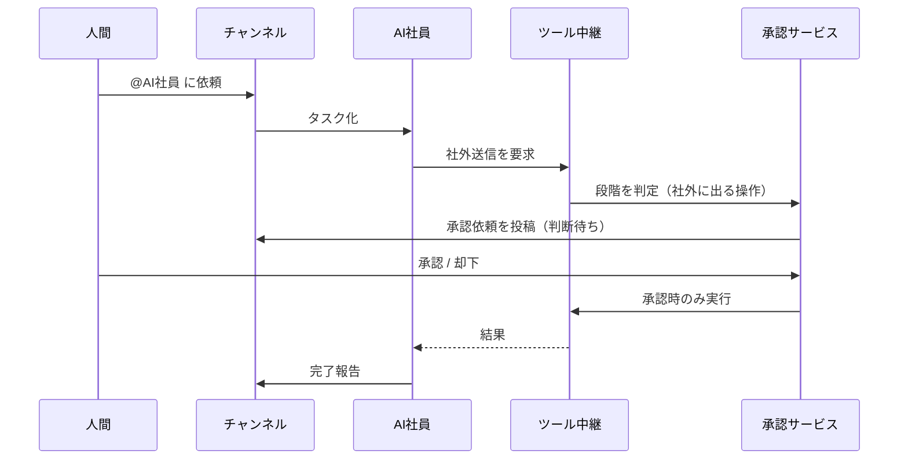

# 技術・権限・障害時の挙動・原価の設計案

- 作成: 2026-11-08（日本時間）、技術・コスト設計担当
- 位置づけ: **提案（未確定）**。確定事項は「前提」の節に書いたものだけです。
- 対象外: 社内wiki・外向けQ&Aの自動生成（現在スコープ外のため、この文書では設計しません）
- **アーキテクチャの現行の正本は [技術仕様 統合版 v0.7](technical/v0.7/README.md) です。** この文書の§2はv0.7を参照する短い説明に置き換えました。§3以降に、v0.7より前の提案（外部LLMの切り替え、外部サンドボックス案など）が歴史的記録として残っている場所では、v0.7を優先してください。

## 1. 前提（決定済み）

- 人間複数と専門AI複数が、同じチャンネルで協業する独立したサービスである。
- AIはAIだと明示する。
- クライアントは、2026-11-08時点の前提では「ブラウザ版から始め、将来Rustのデスクトップアプリを出す」としていました。**現行のv0.7ではこの前提を撤回し、Rust + Slint のネイティブGUIを採用案としています**（ブラウザUIは推奨案として併記。§2）。
- AI社員ごとに、VMなどの実行環境と外部ツール連携を持たせる。**現行のv0.7では、実行環境はAI社員ごとの常時VMではなく、タスクごとのLinuxコンテナsandbox（秘密なし・外へ出られない）です**（§2）。
- サービス名は Pelway。

## 2. 全体構成

現行のアーキテクチャは、**日本国内のローカルホストで動かす統合版 v0.7** です。かつてこの節にあったクラウド案（Cloudflare Durable Objects によるリアルタイム配信、E2B などの外部サンドボックス、複数のLLM提供元の切り替え、Web TypeScript 先行）は、v0.7 の採用により廃止しました。v0.7の要点は次のとおりです。

- 単一のローカル本体（server: axum、PostgreSQL、タスクごとのLinuxコンテナsandbox、LLMゲートウェイはスタブ/llama.cpp）
- 外部LLMへの切り替えをしない国内限定の推論。外部連携は別の境界で、初期off
- クライアントは Rust + Slint のネイティブGUI（ブラウザUIは推奨案として併記）

詳細と根拠:

- 正本: [技術仕様 統合版 v0.7](technical/v0.7/README.md)（本文は `docs/technical/v0.7/body/` の01〜13）
- 図解: [技術アーキテクチャ図（v0.7準拠）](architecture-v0.7.md)
- 原価の計算（§9）は、モデル単価と使用量の仮定を入れ替えればv0.7構成でも使える形で残しています

## 3. 権限と承認（提案）

AI社員の操作を4段階に分け、段階ごとに既定の扱いを決めます。会社の管理者が、AI社員ごとに厳しくする方向へ変えられるようにします。

| 段階 | 例 | 既定の扱い |
|---|---|---|
| 読む | チャンネルやファイルを読む、Webを検索する | 許可済みのデータ範囲・送信先だけ、自動で実行 |
| 社内で戻せる書き込み | 下書きの作成、自分の作業場のファイル変更 | 許可された作業場だけで自動実行し、記録する |
| 社外に出る操作 | メールやメッセージの送信、外部サービスへの投稿 | **毎回、人の承認が必要** |
| 戻せない操作 | 削除、支払い、権限の変更 | **毎回承認が必要で、承認できる人を限定する** |

- 承認依頼には、実際に送る内容をそのまま表示します。承認後に内容が変わったら、承認をやり直します。
- 承認されなかった操作や期限切れの操作は、AIが自動で言い換えて再申請しません。
- AI社員への役割設定と外部アカウントの権限は分けます。AIを作成した人の権限を、すべての依頼に自動で使いません。会社の方針、依頼者の権限、承認者の権限、チャンネルの許可、接続アカウントの権限を満たす範囲に操作を限定します。委任の具体的な設定方式は未決です。
- それとは別に、**実行の直前に**次の許可をすべて確かめます。1つでも欠けていれば実行しません。承認したあとに許可が変わった場合も同じです。
  1. 依頼者：その操作を依頼する権限を持っているか
  2. 会社：会社の方針で、その種類の操作が許されているか
  3. チャンネル：そのチャンネルで、その操作が許されているか
  4. 承認者：その操作の承認権限を現在も持ち、有効な承認があるか
  5. 接続アカウント：使う外部アカウントの権限の範囲に入っていて、接続が取り消されていないか

## 4. セキュリティ（提案）

- **会社ごとの分離**: データは会社IDで分け、実行環境は会社とAI社員ごとに別にします。実行環境を会社間で使い回しません。
- **API鍵を実行環境に置かない方針**: 外部ツールの認証情報は保管庫に置き、ツール中継が呼び出すときにだけ付けます。AIが乗っ取られても、鍵そのものは漏れにくくなります。
- **外への通信を絞る**: 実行環境から外への通信は、許可したあて先だけにする設定を既定にします（設定方法はサンドボックスの提供元ごとに確認が必要）。
- **外から来た文章は命令として扱わない**: Webページ、メール、ツールの結果に書かれた指示で、送信や削除が起きないようにします。モデルへの指示だけに依存せず、ツール中継で権限と承認対象を検査します。読むだけの操作でも、読み出し範囲と外部への送信先を制限します。承認を受けても権限外の操作は実行しません。
- **監査ログ**: 誰が（人間かAIか）、いつ、何を、誰の承認で実行したかを、追記のみのログに残します。
- **AIの明示**: メッセージのデータに「人間かAIか」を必ず持たせ、画面に表示します。
- **データの保存場所**: LLM各社の推論地域の指定は、提供元ごとに違います。例えば Anthropic は、米国内だけで推論する指定をすると料金が1.1倍になります（[Anthropic 料金ページ](https://docs.anthropic.com/en/docs/about-claude/pricing)、2026-11-08確認）。**日本国内に限った推論が選べるかは未確認です。**

## 5. LLMの選び方と切り替え（提案）

- 作業の重さでモデルを分けます。例えば、振り分けや要約は小さいモデル、本作業は中くらいのモデル、難しい作業だけ上位のモデルを使います。
- 同じ内容を繰り返し送る部分（役割の指示や作業の経緯）は、各社のプロンプトキャッシュを使います。キャッシュから読んだ分は、通常の入力単価の1割以下になります（Anthropic、OpenAI の料金ページ。単価は§9）。
- 1社に依存しないよう、LLMゲートウェイで複数社を切り替えられるようにします。ただし、モデルごとに挙動が違うので、切り替えるたびに評価が必要です。

## 6. 障害時の挙動（提案）

| 起きること | 挙動 |
|---|---|
| LLMの提供元が落ちる、または遅い | LLMゲートウェイが、会社で事前に許可され、保存地域・データ利用条件・ツール権限・予算の条件を満たす別モデルへ切り替える案です。条件を満たす切り替え先がなければ、タスクを「止まっている」にしてチャンネルに理由を出します。黙って失敗させません |
| 実行環境が途中で止まる | タスクは最後に記録した段階から再開します。社外に出る操作と戻せない操作は、実行したかどうかを先に確かめてから再開します。確かめられない場合は自動で再実行せず、「結果不明」にして人の確認を待ちます（下の「二重実行への対策」） |
| 承認の待ち中に期限が切れる | 操作は実行せず「期限切れ」にします。AIが自動で再申請はしません |
| 承認後、実行前に権限が取り消される | 実行の直前に権限をもう一度確認し、取り消されていれば実行しません |
| 外部ツールが失敗する | 読むだけの操作は回数を決めて再試行します。書き込みは再試行の前に、すでに成功していないかを確認します |
| 予算の上限に届く | 新しいタスクを受け付けず、管理者に知らせます。実行中のタスクは安全に停止できる箇所で止めます。実行前の費用予約と並列タスクの残予算を管理し、新たな有料処理は予約可能な範囲だけ許可します。遅延計上や停止できない外部処理により厳密な上限を保証できない場合、その条件を表示します |
| リアルタイム配信が切れる | クライアントは再接続し、最後に受け取った発言の続きから取り直します。発言の順番はチャンネル単位でサーバーが決めます |

#### 二重実行への対策（提案）

操作IDだけでは、二重実行を完全には防げません。次の3つを分けて扱います。

1. **Pelway側の操作ID**：社外に出る操作と戻せない操作に、1回限りのIDを付け、一意制約と状態遷移の排他制御で重複発行を抑止する設計を提案します。IDを付けるだけでは不十分で、外部サービスが受け取ったかどうかまでは分かりません。
2. **外部サービス側の冪等性**：同じリクエストを2回受けても1回分として扱う仕組みを、外部サービスが持っている場合だけ、そのキーを渡します。持っているかどうかは外部サービスごとに違うので、連携ごとに確認して記録します。持っていない連携は、二重送信が起こりうるものとして扱います。
3. **応答が途切れたときの結果照会**：送信したあと応答が返らなかった場合、まず外部サービスに結果を問い合わせます（送信済みの一覧を見るなど）。照会できない場合や、照会しても結果が分からない場合は、**自動で再実行しません**。タスクを「結果不明」にして、人に確認を頼みます。外部サービスの冪等キーを使った場合でも、キーの有効期間が過ぎていれば同じ扱いにします。

承認内容の変更、権限の取り消し、障害後の再開は、重要な**検証項目**です。競合との違いを確認できるまでは、「技術上の独自性」とは呼びません。

## 7. MVPの開発期間の目安（仮定）

**仮定**: フルスタックのエンジニア2〜3人。実行環境とLLMは外部サービスを使い、自前でVMを運用しない。

| 段階 | 内容 | 目安 |
|---|---|---|
| 1 | チャット（チャンネル、メンション、リアルタイム配信、ログイン） | 4〜6週 |
| 2 | まずAI社員1種で実行経路を確認し、その後に複数の役割へ拡張（実行環境、LLMゲートウェイ、タスクの状態） | 4〜6週 |
| 3 | 承認、監査ログ、外部ツール連携2〜3個 | 3〜4週 |
| 4 | 社内での試用と修正 | 2〜4週 |

合計の目安は3〜5か月です。これは技術担当による概算で、実績データに基づく見積もりではありません。複数AIでの協業や障害試験を含むPRD全体の工数は再見積もりが必要です。

## 8. 未決事項

- Rustデスクトップの作り方（Tauriなど）と、出す時期
- 実行環境の提供元（E2B、Fly.io、Cloudflare Containers など）。料金は§9。AI社員の作業場をどのくらい長く残すかで向き不向きが変わる
- 日本国内でのデータ保存・推論が必要になる顧客をどう扱うか
- 外への通信の許可先を、誰がどの単位で決めるか

## 9. コスト仮説：AI社員1人あたりの月の原価

- 作成: 2026-11-08（日本時間）、技術・コスト設計担当
- 位置づけ: **仮説**。単価は公式ページで2026-11-08に確認しました。使用量はすべて**仮定**で、実測ではありません。

### 9.1 結論

- ここでの原価は、会社単位の固定費などを除いた**部分原価**です（§9.6）。
- **今回の仮定では**、部分原価の8〜9割がLLMの利用料です。使用量の仮定が変われば、この比率も変わります。
- 仮定の使用量では、AI社員1人あたりの月の部分原価は、**ライトで約28ドル、標準で約100ドル、ヘビーで約265ドル**です。
- 部分原価だけに対して粗利率60%を仮置きした料金の**参考値**は、**ライトで約1.0万円、標準で約3.8万円、ヘビーで約9.9万円**です（1ドル150円の仮定）。
- 使用量の差が大きいので、**定額で使い放題にすると赤字になる危険があります**。月のタスク数や利用額に上限を付ける料金にすべきです。

### 9.2 公式単価（2026-11-08確認）

#### LLM（100万トークンあたり、米ドル）

| 提供元・モデル | 入力 | 出力 | キャッシュ読込 | キャッシュ書込 | 出典 |
|---|---|---|---|---|---|
| Anthropic Claude Sonnet 5 | $2 | $10 | $0.20 | $2.50（5分） | [Anthropic 料金](https://docs.anthropic.com/en/docs/about-claude/pricing) |
| Anthropic Claude Haiku 5.5（10万トークン以下） | $0.10 | $0.50 | $0.01 | $0.125（5分） | 同上 |
| Anthropic Claude Opus 5.5 | $4 | $20 | $0.20 | $5（5分） | 同上 |
| OpenAI gpt-6.1-sol（短い文脈） | $2.00 | $10.00 | $0.10 | $2.50（30分） | [OpenAI API 料金](https://platform.openai.com/docs/pricing) |
| OpenAI gpt-6-luna（短い文脈） | $0.10 | $0.50 | $0.01 | $0.125（30分） | 同上 |

- 両社とも、急がない処理（Batch）は入力・出力が半額です（同上）。
- Anthropic は Claude 4.7以降で、同じ文章が約30%多いトークン数になると書いています（同上）。下の計算のトークン数は、そのモデルで数えた量として仮定しています。
- Google Gemini の料金ページは取得できなかったため、**未確認**です。

#### 実行環境（AI社員ごとのVM）

| サービス | 単価 | 出典 |
|---|---|---|
| E2B | vCPU $0.000014/秒、RAM $0.0000045/GiB秒、ディスク無料。Proプランは月$150（同時100台まで）＋利用料 | [E2B 料金](https://e2b.dev/pricing) |
| Fly.io Machines | shared-cpu-2x・2GBを米国iad/ewrで30日常時起動すると月$13.39。他地域や31日月は異なる。停止中はrootfs $0.15/GB月。ボリューム $0.15/GB月 | [Fly.io 料金](https://fly.io/docs/about/pricing/) |
| Cloudflare Containers | メモリ $0.0000025/GiB秒、CPU $0.000020/vCPU秒（使った分だけ）、ディスク $0.00000007/GB秒。Workers有料プラン月$5に無料枠あり | [Cloudflare Containers 料金](https://developers.cloudflare.com/containers/pricing/) |

1時間あたりに直すと次のとおりです（計算値。プラン固定費・各種追加料金・無料枠を除く）。
- E2B（2vCPU・4GiB）: 約$0.166
- Fly.io（shared-cpu-2x・2GB、iad/ewrの30日を720時間として換算）: 約$0.019
- Cloudflare（standard-2: 1vCPU・6GiB・12GBディスク。CPU使用率30%と仮定）: 約$0.079

#### ストレージ・リアルタイム配信

| サービス | 単価 | 出典 |
|---|---|---|
| Cloudflare R2 | 標準 $0.015/GB月。外への転送料なし。操作料金や別サービスの料金は別 | [R2 料金](https://developers.cloudflare.com/r2/pricing/) |
| Cloudflare Durable Objects | 月100万リクエストを超えた分が $0.15/100万（受信WebSocketメッセージは計算用に20件で1リクエストへ換算、送信メッセージは請求対象外。接続開始やストレージは別）。実行時間は月40万GB秒を超えた分が $12.50/100万GB秒 | [Durable Objects 料金](https://developers.cloudflare.com/durable-objects/platform/pricing/) |

### 9.3 原価の式

この試算で対象とするAI社員1人の月の部分原価を、次の式で計算します。

$$
\text{部分原価} = N \times \left( C_{\text{LLM}} + h \times R_{\text{VM}} \right) + S
$$

- `N`：月のタスク数（仮定）
- `C_{\text{LLM}}`：1タスクのLLM費用
- `h`：1タスクで実行環境が動く時間（仮定）
- `R_{\text{VM}}`：実行環境の1時間あたりの単価（公式単価から計算）
- `S`：ストレージの月額

1タスクのLLM費用は、次の式で出します。

$$
C_{\text{LLM}} = \frac{T_{\text{in}} \left( r_{\text{hit}} P_{\text{hit}} + r_{\text{write}} P_{\text{write}} + r_{\text{raw}} P_{\text{in}} \right) + T_{\text{out}} P_{\text{out}}}{10^6}
$$

- `T_{\text{in}}`、`T_{\text{out}}`：1タスクの入力と出力のトークン数（仮定）
- `r`：キャッシュ読込、キャッシュ書込、通常の割合（仮定）
- `P`：100万トークンあたりの公式単価

部分原価だけを対象とした参考価格は、`部分原価 / (1 - m)` と計算します。`m` は仮置きの粗利率で、未計上費用を含む事業全体の粗利率や実際の料金下限を意味しません。

### 9.4 仮定

| 項目 | 仮定 |
|---|---|
| 1タスクのトークン | 入力6万（うちキャッシュ読込70%、キャッシュ書込20%、通常10%）、出力3,000 |
| モデルの配分 | Sonnet 5 が70%、Haiku 5.5 が30% |
| 1タスクの実行時間 | 実行環境が3分動く |
| 実行環境 | E2Bの2vCPU・4GiBを、タスクのときだけ起動 |
| ストレージ | AI社員1人あたり、作業場10GB（Fly.ioのボリューム単価で計算）とR2に5GB。**実行はE2B、作業場の保存はFly.io という組み合わせは、保存と復元の方法を検証していない概算です** |
| 月のタスク数 | ライト400、標準1,500、ヘビー4,000 |
| 為替 | 1ドル150円 |

1タスクあたりのLLM費用（計算値）は次のとおりです。
- Sonnet 5: 約$0.080
- Haiku 5.5: 約$0.004
- Opus 5.5: 約$0.152
- gpt-6.1-sol: 約$0.076
- 70%と30%の配分: 約$0.058

### 9.5 AI社員1人あたりの月の原価

部分原価に基づく計算例です。右端の参考価格は、販売価格の下限や事業全体の粗利率を示しません。

| 区分 | タスク/月 | LLM | 実行環境（E2B） | ストレージ | 部分原価 | 円換算 | 部分原価ベース60%（参考） | 部分原価ベース70%（参考） |
|---|---|---|---|---|---|---|---|---|
| ライト | 400 | $22.99 | $3.31 | $1.58 | **$27.88** | 約4,200円 | 約10,500円 | 約13,900円 |
| 標準 | 1,500 | $86.23 | $12.42 | $1.58 | **$100.22** | 約15,000円 | 約37,600円 | 約50,100円 |
| ヘビー | 4,000 | $229.94 | $33.12 | $1.58 | **$264.64** | 約39,700円 | 約99,200円 | 約132,300円 |

#### 感度（LLMを変えた場合の、標準区分のLLM費用）

- すべてSonnet 5: $120.60
- すべてOpus 5.5: $228.60
- 実行環境をFly.ioの常時起動にした場合: 米国iad/ewrで30日常時起動の計算なら月$13.39。追加メモリ、通信、保存などは別

### 9.6 この表に入れていないもの

- 会社単位の固定費: E2B Pro の月$150、Workers有料プランの月$5、DB、監視、ログ
- チャットのリアルタイム配信の費用（Durable Objectsは、上の単価から見てAI社員1人あたりでは小さいと見込みますが、**実測していません**）
- 埋め込みや検索の費用
- 決済手数料、サポートの人件費、失敗したタスクのやり直しの費用

### 9.7 料金設計への示唆（提案）

- AI社員1人あたりの定額に、月のタスク数か利用額の上限を付けます。上限を超えた分は従量にするか、止めるかを会社が選べるようにします。
- 使用量の計測と予算の上限はLLMゲートウェイが持ちます。現行のv0.7では外部LLMへの切り替えをしないため（llama.cppが第一候補）、複数の提供元を切り替える前提で書かれた§5の提案は旧案であり、料金設計の根拠にはしません。原価の単価と使用量の仮定は§9のとおりです。
- 原価を下げる手段は、効果が大きい順に、モデルの振り分け、キャッシュ、急がない処理のBatch化です。
- 実測が出たら、この表の仮定（とくに1タスクのトークン数）を置き換えます。

## 10. 公開前レビューで追加した要件［提案］

### 承認を実行内容に結び付ける

承認記録は、会社、タスク、操作ID、対象の外部アカウント、宛先、本文と添付の版、承認者、有効期限に結び付けます。実行直前に内容と権限を照合し、どれかが変わった場合は停止します。複数人が同時に承認しても、同じ承認を別の操作へ使い回しません。実行後の確定記録がない場合は、自動的に成功扱いしません。

### ブラウザ操作でも承認を迂回させない

APIの鍵をVMの外に置いても、ブラウザのログイン状態は操作権限を持ちます。ログイン済みブラウザから任意の更新ができる構成では、ツール中継だけで承認を強制できません。MVPでは、外部更新を検査可能な連携経路に限定するか、同等の強制力を持つブラウザ制御を実装・検証します。検証できない経路で外部更新を許可しません。

### 保存と監査の検証

会社IDを持つデータの検索と書き出し、添付URL、ログ、実行環境、キャッシュを含めて、他社データが返らない試験を行う案です。保存地域、バックアップ、復旧、保持期限、書き出しと削除の条件は採用前に決めます。日本国内限定の保存・推論が実現できるとは現時点では約束しません。

追記専用ログだけで管理者による改変まで防げるとは主張しません。書き込み権限、保全、保持期限、機密内容の削除と監査証跡を分けて設計します。

### 原価表を使う条件

キャッシュの割合は互いに重複しない入力トークンの比率で、合計を1とします。モデル配分はタスク数の比率とし、どのモデルも同じトークン量という仮定です。6万入力トークンと3,000出力トークンは、1タスク内の全LLM呼び出しを合計した量です。呼び出しごとの量と解釈すると過小見積もりになります。

ストレージの未丸め値は月$1.575で、表は小数第2位に丸めています。合計も未丸め値から計算するため、表示値の和とはわずかに異なる場合があります。無料枠や初回クレジットを差し引いた採算保証ではありません。

上の時間単価は構成・地域・CPU性能が違う参考値で、同じ性能の比較ではありません。E2BのHobbyは連続1時間、Proは連続24時間というプラン上限があり、社員の作業場を永続保存する設計は別途検証します。Proの固定費が必須かどうかは同時実行数と必要機能で判断し、会社ごとに必ず$150かかると決め付けません。

総原価には、共有基盤固定費の配賦、DBとバックアップ、監視、監査、認証、ネットワーク転送、ストレージ操作、ツールの従量課金、ブラウザの画像入力、失敗・再試行、サポート、決済手数料などを加えます。本表の金額は全費用を含む販売価格の下限ではありません。採用する料金は実測後に決めます。

[プロダクト要件](prd.md)と[段階的ロードマップ](roadmap.md)を合わせて検証します。
