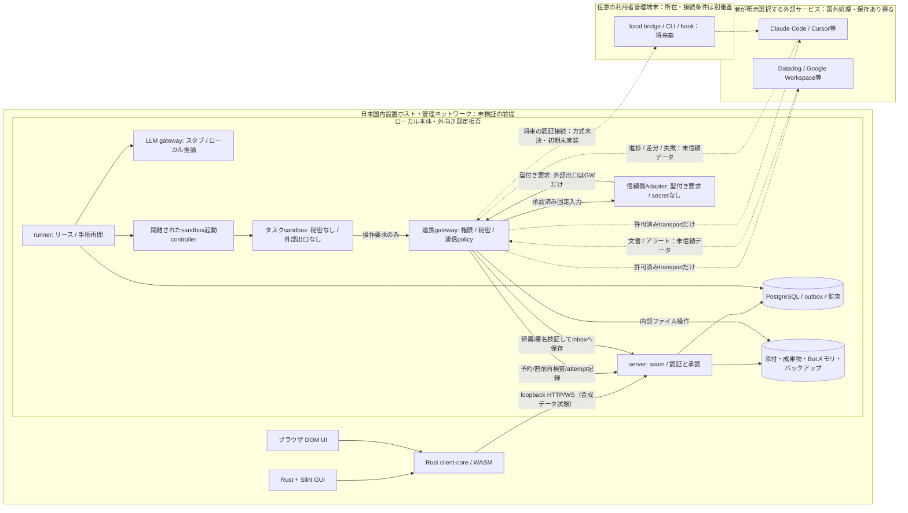
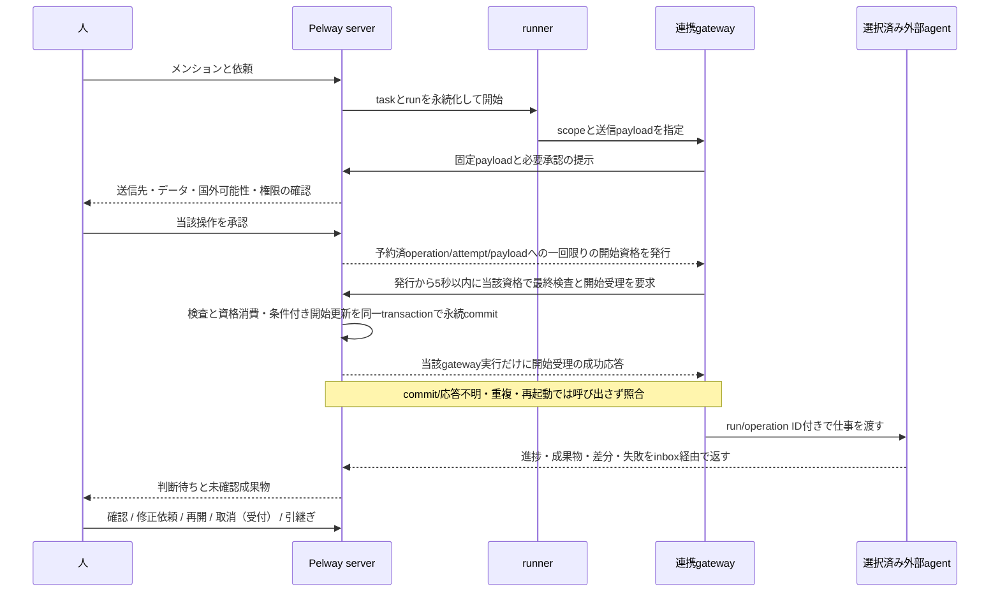

# 01 ローカル構成と責任分界

この章は構成の説明。国内に物理設置された管理端末で動くローカル構成を設計する。設置場所と管理状態は未確認。クラウド本番を構築しない。

## 全体図

実線の本体データは国内ローカル保存・処理の設計。破線は利用者選択の例外経路で、本体の「国外送信なし」に含めて保証しない。外部から取り込んだ成果物のPelway保存コピーは国内に置く。提供元に残るコピー・ログ・セッションは外部サービスの責任分界。local bridgeは利用者端末で動く案で、管理host内に固定しない。ただし国外端末への接続許可を得た意味ではなく、所在/認証/端末管理を別に確認する。

## ホストとコンテナ

| 部品 | 実行 | ビルド・試験 |
|---|---|---|
| ネイティブGUI | 各ホストの通常プロセス | Windows MSVC、macOSのSDK、Linuxのネイティブ環境。IME、GPU、通知、読み上げはホストで試す |
| Web UIとWASM | ホストブラウザ | 静的資源のビルドはコンテナ可。ブラウザ機能の試験はホスト |
| server、runner、gateway | Linuxコンテナ。論理境界として別プロセス | Linux向けイメージ。最低3プロセスであり「2プロセス」とは呼ばない |
| sandbox controller | 信頼するホスト/コンテナランタイム側の限定API | 任意のruntime socketをBotやsandboxへ公開しない |
| DB、ファイル、推論 | Linux側。GPU推論がホストAPIを要する場合は国内ホストの別プロセス | CPU別イメージとdriverを検証。macOSのGPUをLinuxコンテナから当然使えるとはしない |
| サンドボックス | 同一ランタイムの独立したコンテナ | 入れ子コンテナを既定にしない。ホストホームやruntime socketをマウントしない |

WindowsのWSL 2とmacOSのApple containerはLinux実行基盤。Windows/macOS GUIの製品試験や署名を代替しない。GUIからの入口はloopback限定。localhostでもOrigin検査、CSRF対策、認証を省略しない。

## 仕事の往復

Adapter未実装の初期ローカル検証では、外部agentを疑似サービスに置き換える。外部サービス選択の許可は、現在の実接続・実送信の承認ではない。

## 永続化と正しさ

業務の正本はserverとPostgreSQL。状態変更、監査、配信用outboxは同じDBトランザクションで確定する。WebSocketは通知経路であり正本ではない。DBキューを使い、ローカル初版へ別のメッセージブローカーを持ち込まない。

Botの人格、役割、メモリと、実行コンテナの寿命を分ける。ファイルとチェックポイントは国内の管理領域に残す。担当交代で他Botのボリューム全体を渡さず、taskに結び付く検査済み成果物・手順だけを権限付き参照で引き継ぐ。

配置先の共通境界はPlacementPolicyとし、04/10に定義する。今は日本local単一で、将来のUS/EU/JPは選択肢の例示だけ。外部連携4製品も例示であり限定しない。

初期のloopback構成は、単一host上の複数アカウントによる合成データ検証専用。別端末の実メンバーが共同利用できる完成品ではない。LAN公開・TLS・端末認証・具体的ローカル認証方式は未決とし、localhostというだけで認証を省かない。APIの承認検査/attempt記録をgatewayからserverへ要求し、成功後だけ外部transportを呼ぶ。

## 全構成に適用する情報取扱い制御

server/runner/推論/gateway/公開/検索/運営/復旧は[12](12-communication-secrecy.md)の現権限・目的・根拠とsource制限を共有する。保存・quota・期限・有人枠は[13](13-operational-defaults.md)の選定値に従う。P方針は内部開始受理を境界とする取消契約の暫定変更であり、S1の技術的解消や実I/O許可ではない。未決の正本は[08](08-decisions-open.md)だけとする。

明示メモリは作成/根拠を確認した明示更新から最長365日、全source期限以内。閲覧で延長せず、毎回全件をAIに入力しない。必要範囲だけを取得し、将来の索引/RAGを初期必須機能には戻さない。
