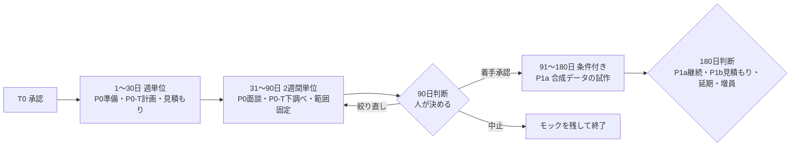

# Pelwayの中期マイルストーン案（T0から180日）

2026-11-08（日本時間）作成。v0.1。原本は[長期計画v0.5](long-term-milestones.md)と[status.md](status.md)。長期計画と食い違う場合は長期計画を優先し、本書を直す。

> **これは実行承認ではありません。** 開始日T0、投入時間、予算、担当者はどれも未承認です。T0は濱田さんが計画と投入時間を承認した日とします。この計画を作っただけでは、面談の募集・連絡・送信、アカウント作成、支出、公開、Git操作は行いません。

## 要約

### 推奨する到達点（180日）
- **90日まで（確定させたい範囲）**：P0の顧客検証とP0-Tの技術下調べを終え、「P1aに着手する／範囲を絞り直す／中止する」を判断できる証拠をそろえる。
- **91〜180日（条件付きの見通し）**：90日の判断で着手が承認された場合だけ、合成データのP1aを進める。180日でP1aやMVPが完成するとは約束しない。P1bは180日の範囲外とし、着手時期はP1aの実測から再見積もりする。

### 最初の2週間でやること
1. 濱田さんの投入時間・担当者・支出方針（3点、下記）の確認。これが決まるまで1週目は始めない。
2. 候補業務を一つに絞る案と、面談ガイド、匿名化ルールの草案を作る（企画・市場のbot）。
3. 技術下調べの計画、メール送信の提供元候補の公式仕様の読み込み（技術のbot。新規支出なし）。
4. 状態名の理解試験（判断待ち・送信中・送信済み · 顧客回答待ち・結果不明）の設問の草案（UIのbot）。
5. MVPの機能を分解した見積もり表の枠を作る（技術・プロダクトのbot）。数字はまだ入れない。

### 濱田さんが決める最小事項（長期計画の3点と同じ）
1. 最初の30日に使える時間と、実装・顧客対応を担う人。
2. 最初に聞く対象と募集方法。実際の連絡や面談は濱田さんの承認と対応が必要。
3. 新規支出ゼロで進めるか、30日分だけの検証上限を別に設けるか。

## 1. 前提と書き方の決まり

- **工数は未見積もり。** 長期計画の週15時間、P0の140時間、P1aの290時間、時間枠と予算の比較例は、合意済みの値ではない比較仮定です。本書では時間の数字を確約として使いません。30日で出す人時見積もりで置き換えます。
- **同じ人の時間を二重に数えない。** 人間の担当者が1人の場合、顧客面談、レビュー、承認、実装は同じ時間枠から出ます。並行と書いた作業も、人間の作業が重なる週は順番に並べ直します。botの作業時間は人の工数に数えません。
- **担当の区別。** 「人」は濱田さんか、今後決める人間の担当者です。「bot」は本チームの各係で、草案・調査・集計・レビューだけを行います。面談、送信、契約、支出、アカウント作成、試験の合否の最終判断は人が行います。
- **数字の出所。** 「原文」は長期計画v0.5にある提案値です（どれも実績や確定目標ではありません）。「本書の提案」は今回追加した値です。
- **範囲外。** 社内wikiと外向けQ&Aの自動生成、UI外観の再設計、実顧客データ・実認証情報・実取引先への送信、P1bとP2の実施。
- **安全要件は日程に合わせて削らない。** 遅れた場合は範囲を絞るか、延期するか、増員を比較します。

## 2. 全体の流れ

## 3. 最初の30日（週単位）

| 週 | 成果物 | 担当案 | 依存 | 検証証拠 | 通過／見直し／中止 |
|---|---|---|---|---|---|
| 1週 | 投入時間・担当・支出方針の記録。候補業務の比較表。匿名化ルール案 | 人：濱田さんが3点を決める。bot：企画が記録と比較表 | T0の承認 | 決定内容と日付の記録 | 通過：3点が決まる。見直し：時間が取れない場合は30日の範囲を減らす。決まらなければ開始しない |
| 2週 | 面談ガイド、比較条件（Slack＋Agentforce、Teams＋Copilot、Context、CircleChat等の利用経験、移行・併用の可否）。状態名試験の設問案。技術下調べ計画 | bot：市場・企画・UI・技術。人：内容の確認 | 1週の業務選定 | 各担当のレビュー記録 | 通過：ガイドと設問に各担当の反対なし。見直し：対象業務が広すぎる場合は一つに絞る |
| 3週 | 募集方法と連絡文の草案（送信はしない）。メール送信の提供元2〜3候補の冪等キー・結果照会の公式仕様の調査記録 | bot：企画が文案、技術が仕様調査。人：連絡文の承認と実際の送信 | 2週の成果物、送信の承認 | 公式仕様の出典リンクと確認日 | 通過：連絡文が承認される。仕様が確認できない候補は「未確認」と記録し、メール一般に冪等性があるとは仮定しない |
| 4週 | MVPの機能別人時見積もり（P1aとP1bを分ける）。原価の費目一覧と停止条件の案。少なくとも2チームの具体的な仕事の聞き取り（原文の案） | bot：技術・プロダクト・UIが見積もり。人：面談の実施 | 面談相手の同意、人の時間 | 見積もりの前提・範囲・根拠。匿名化した面談記録 | 通過：P1aとP1bの人時が別々に出る。見直し：P1aが比較仮定の290時間に収まらない場合、範囲を絞る・延期・増員の3案を比較。面談相手が見つからなければ募集経路を見直す |

**30日の判断（人が決める）**：面談を続けるか、募集経路か対象業務を見直すか。30日の成果物は課題の具体例、試す業務、人時と費用の見積もり、次へ進むかの判断材料で、製品の完成ではありません。課題の根拠は面談で集めた実例だけとし、一般統計から需要を推定しません（市場担当の条件）。

## 4. 31〜90日（2週間単位）

| 期間 | 成果物 | 担当案 | 依存 | 検証証拠 | 通過／見直し／中止 |
|---|---|---|---|---|---|
| 31〜44日 | 面談の継続。状態名の理解試験（架空のチーム例、5人前後。原文）。送信中を送信済みと取り違えないかを記録 | 人：面談と試験の実施。bot：UIが試験資料と集計、市場が記録 | 参加者の同意、承認済みのモック | 人数、状態ごとの正答、危険な再送判断の有無 | 半数以上が読み違えたら呼び名から見直す（原文）。半数未満でも危険な再送判断があれば優先して直す |
| 45〜58日 | P0-Tの下調べ（承認された範囲だけ）：合成ファイルで停止・再開10回、未許可の通信先の遮断、予算上限後に新しいLLM呼び出しを始めないこと（すべて原文の条件） | bot：技術が手順と記録の草案。人：アカウント作成と実施の承認 | 無料枠の条件確認、または支出の承認。新規支出ゼロなら机上調査だけに縮める | 実行ログと結果。10回合格を耐久性の保証とは扱わない | 隔離・保存・承認の経路を満たせなければ、実装へ進まず構成か範囲を見直す |
| 59〜72日 | 4チーム・計8人程度の面談（原文）は長期計画§7どおり60日までの完了を目指し、この区間は未達分の補完と記録に使う。1業務の要件案、受け入れ条件A〜Cの試験一覧、権限と実行経路の危険箇所の一覧 | 人：面談。bot：プロダクト・技術・企画 | 面談相手の確保 | 匿名化記録、要件案、試験一覧 | 人数に届かなくても達成扱いにしない。届かない理由を記録する |
| 73〜90日 | P0の証拠のまとめ。協力候補2チームの条件（扱えるデータ・担当者・試す仕事）の確認。MVPの範囲固定。P1a/P1bの人時・総原価・安全試験計画、P1aの支出上限と停止条件の案 | bot：全担当がレビューし、企画が統合、Grok Botが不足を確認。人：協力条件の確認と判断 | 59〜72日の成果物 | 各担当の合格・不合格・未測定を分けた報告 | 下の90日判断へ |

**P0の通過条件（原文どおり）**：4つの独立したチームから利用者と購入判断者を合わせて8人程度に聞く。3チーム以上で同種の仕事が週1回以上起きることを具体例で確かめる。2チーム以上が、扱えるデータ・担当者・試す仕事を決めたうえで限定試験への協力に同意する。連絡先を手に入れただけでは同意と数えない。

**見直しと中止（原文どおり）**：募集できない、チャット移行を望まない、購入判断者の課題でない、顧客の契約で移行も併用もできない場合は、募集経路か対象業務を一度絞り直す。絞り直しても独立チャットを試す理由がない、または時間・損失上限が承認されなければ中止し、モックを残す。

**90日の判断（人が決める）**：P1a着手、絞り直し、中止のどれか。着手には、実装責任者、1社1連携に絞った人時見積もり、テスト用アカウント・宛先・費用の承認が必要です。

## 5. 91〜180日（条件付きの見通し）

90日の判断で着手が承認された場合だけ進めます。月単位の見通しで、日程の約束ではありません。

| 期間 | 見通し | 依存 | 次の判断 |
|---|---|---|---|
| 91〜120日 | P1aの土台：別々の人間アカウント2つとAI2役、1社、合成データ、隔離したテスト環境。メンション依頼、役割付きAI、状態の区別、決定内容の固定、最小監査ログ | P0とP0-Tの通過、実装責任者、承認済み費用 | 月末に実測の人時と見積もりを比べる |
| 121〜150日 | 送信承認と引き継ぎ、結果不明での停止。メール送信を1連携だけ、許可されたテスト宛先で試す（提供元は冪等キー・結果照会・承認の強制を確かめてから選ぶ）。幅360 CSS pxでは判断待ちの一覧と停止理由が読めるだけにし、承認ボタンは置かない | 連携先の仕様確認、テスト送信の承認 | 安全試験の準備状況を確認 |
| 151〜180日 | 適用できる安全試験を全件実施（長期計画§6）。応答断は各連携20回以上、権限取消は各条件5回以上（原文）。外部文章に命令を埋め込む試験。WCAG 2.2 AAの検査とダークモードの群青のコントラスト修正。受け入れ条件A〜Cの判定 | 試作の実装の進み具合 | 180日の判断へ |

**P1aの通過条件（原文どおり）**：合成データの範囲でA担当交代・B承認内容の変更・C失敗後の再開をすべて満たし、適用できる安全試験を全件実施する。別アカウントと複数AIを、単一アカウントの台本で代わりにしない。主な試作画面がWCAG 2.2 AAに適合する。P1aを通過しても、実顧客データの利用許可や実データを扱えるMVPの完成とは数えない。

**180日の判断（人が決める）**：P1aを続ける、P1bを再見積もりして着手を検討する、延期する、増員を検討する、のどれか。工数を超えたら範囲を絞る・延期・増員を比較します。外部送信を外して下書き版に戻す場合、実行機能の通過条件は未達のままです。

## 6. 区間をまたぐ宿題

| 宿題 | 期限案 | 担当案 | 完了の証拠 |
|---|---|---|---|
| メール送信の冪等キーと結果照会の公式仕様 | 3週（遅くとも60日） | bot：技術 | 候補ごとの出典と確認日。確認できないものは「未確認」 |
| 総原価の費目、支出上限、停止条件の見積もり | 4週に初版、90日に更新 | bot：技術。人：上限の承認 | 提供元ごとに費目を置き換えた計算（二重計上なし）、無料枠は条件確認まで計上しない |
| 送信中の理解試験 | 31〜44日 | bot：UI。人：実施 | 状態ごとの正答と危険判断の記録 |
| 幅360 CSS pxの読み取り専用表示 | 設計は90日まで、実装と検査はP1a | bot：UI・技術 | 崩れないこと、判断待ちと停止理由が読めること、承認ボタンがないこと |
| 競合の再確認（Context、CircleChat、Slack、Teams等） | 90日判断の前 | bot：市場 | 公式記載・実機・未確認を分けた記録 |

## 7. 本書の提案として追加した数字

- 「最初の2週間」の範囲、各区間の日数の区切り（1〜30日を週単位、31〜90日を2週間単位）。
- メール仕様の調査を3週、総原価の初版を4週とする期限案。
- それ以外の人数・回数・条件はすべて長期計画v0.5の原文の提案値です。

## 8. 未決事項

- T0、投入時間、担当者、支出方針（最小3点）。
- P1a/P1bの人時。週15時間・140時間・290時間は比較仮定のまま。
- 面談相手と協力チーム。実際の連絡は濱田さんの承認と対応が必要。
- 技術下調べのアカウント作成と無料枠の利用。
- 単独で進めるか、増員を検討するか。
- 作業用PRDの「送信中」と公開用PRDの状態遷移の整合（別作業）。
