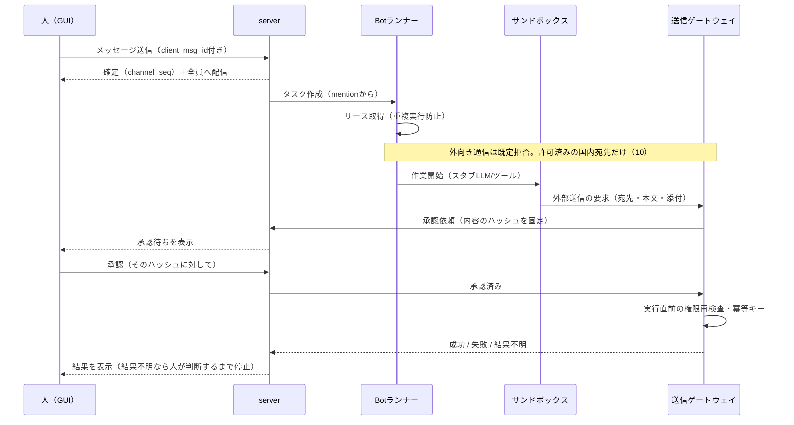

# 01 アーキテクチャ（ローカル構成・初版）

対象はローカル動作構成だけ。クラウド本番・課金サービスは対象外（既存の公開 technical.md のクラウド案は変更しない。差分は08）。

## 1. 全体図

```mermaid
flowchart LR
  subgraph HOST[ホストOS：Windows / macOS / Linux]
    N[ネイティブGUI<br/>Rust + GPUI]
    B[ブラウザ<br/>TS UI + client-core(WASM)]
    N --- CC1[pelway-client-core<br/>Rust・SQLiteキャッシュ]
  end
  subgraph BE[バックエンド：WSL 2 / Apple container / Linuxコンテナ]
    API[pelway-server<br/>axum：HTTPS + WebSocket]
    DB[(PostgreSQL)]
    OBJ[(ファイル保存<br/>ローカルボリューム)]
    RUN[Botランナー<br/>タスク実行・リース]
    LGW[LLMゲートウェイ<br/>スタブ/ローカル推論<br/>外部は無効]
    TGW[ツール・送信ゲートウェイ<br/>承認・冪等キー]
    MAIL[ダミーメールサーバー<br/>外部メールは無効]
    SBX[[タスクごとの<br/>サンドボックス・コンテナ]]
  end
  CC1 -->|WSS/HTTPS localhost| API
  B -->|WSS/HTTPS localhost| API
  API --> DB
  API --> OBJ
  RUN --> DB
  RUN --> LGW
  RUN --> SBX
  SBX -->|MCPのみ| TGW
  TGW --> MAIL
```

- サンドボックスからの通信は**ツール・送信ゲートウェイだけ**に許可し、それ以外の宛先は遮断する（長期v0.5の安全試験12の考え方を維持）。
- APIの鍵やDBの管理者キーはサンドボックスに入れない。ゲートウェイが代理で使う。

## 2. 境界（ホストGUIとコンテナ内バックエンド）

| 要素 | どこで動くか | どこでビルドするか | 理由 |
|---|---|---|---|
| ネイティブGUI | ホストOSのプロセス | ホストOSのRustツールチェーン（Windowsは MSVC、macOSは Xcodeコマンドラインツール） | GPU・IME・通知・クリップボード・スクリーンリーダーはホストのAPIを使う。コンテナ内では検証できない |
| ブラウザ版 | ホストのブラウザ | コンテナ内でも可（静的ファイル） | 配信だけならコンテナでよい |
| server / Botランナー / LLMゲートウェイ / ツールゲートウェイ | コンテナ（Linux） | コンテナ内（Linuxターゲット） | 本番に近い形、ホストを汚さない |
| サンドボックス | コンテナ内の子コンテナ、または同じランタイムの別コンテナ | イメージをビルド | タスクごとに作って捨てる |
| ダミーメール・スタブLLM | コンテナ | コンテナ | 外部へ出さない |

ホストとバックエンドの通信は `localhost` 経由のポートだけ。Windowsでは WSL 2 のポート転送、macOSでは Apple container の公開ポートを使う（05で手順と制約）。

## 3. データの流れ（人がBotにメンションして、Botが外部に送る）



## 4. 実行の流れ（タスクの状態）

詳細は03。状態はプロダクト入力R1の9状態（03 §2）。どの状態でも**状態変化はDBの1トランザクションで記録し、監査ログに追記**する。

## 5. プロセス分割の方針
- 初版は `pelway-server`（API＋配信）と `pelway-runner`（Bot実行）の**2プロセス**。同じDBを使い、タスクの受け渡しはDBのキュー（`SELECT … FOR UPDATE SKIP LOCKED`）で行う。メッセージブローカーは入れない（ローカル構成で部品を減らすため。将来の分割は08の未決）。
- ゲートウェイはランナーと別プロセスにして、サンドボックスから鍵を見えなくする。
