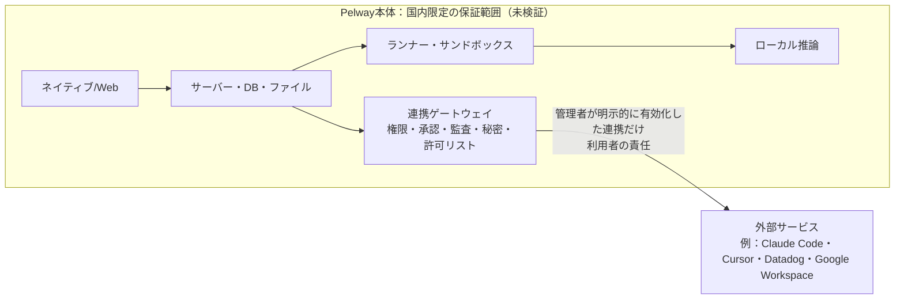

# 技術入力：推奨スタック・実行基盤・同期・国内限定

2026-11-08（日本時間）、AI協業チャット技術・コスト設計係。第3版（22:3x、外部連携の責任分界・将来リージョン・連携先を限定しない、を反映）。本文の下書きは `input/technical-draft/`（README・01〜10）。統合は企画係さんが行う。既存の公開文書・長期v0.5・中期v0.4・短期v0.1は変えていない。どの候補も実機では試しておらず、性能の数値はすべて**未測定**。

## 1. 推奨（初版）
| 部分 | 推奨 | 代替 | 採用阻害 | 実装前の検証 |
|---|---|---|---|---|
| ネイティブUI | Rust＋Slint（UI担当と一致。WebViewなし） | egui。性能の計測にはGPUIも残す | 大規模リストでのアクセシビリティの性能（slint#3867）、ライセンス条件 | 3OSで日本語IME・スクリーンリーダー・10万件（draft/07） |
| Web版 | TypeScript＋DOM。型・同期・再接続はRustのWASM（`pelway-client-core`） | 全部TypeScript | UIを2回作る工数 | WASMの大きさ・起動 |
| 日英 | Fluent（Rust）とWeb側の共通キー、ICU4X／Intl | — | — | 日本語の試験（draft/06） |
| サーバー | Rust（tokio・axum）＋PostgreSQL（sqlx）、サーバーとランナーの2プロセス | — | — | — |
| 同期 | チャンネルごと`seq`、`client_msg_id`で冪等、`stream_pos`で再開、`resync_required` | — | — | 切断・重複・順序（draft/04） |
| Bot | 9状態（プロダクトR1）、リース＋フェンシング、承認ごとに冪等キー1つ、結果不明は人が判断、追記型の監査、秘密はサンドボックスに入れない、ツールはMCPゲートウェイ経由（rmcp） | — | — | draft/03 |
| 隔離 | タスクごとの使い捨てコンテナ＋Botごとの作業用ボリューム | Botごとの常時VM | VMより弱い。本番水準は未決 | 脱出・資源上限 |
| ローカル構成 | Windows：GUIはMSVCでネイティブ、バックエンドはWSL 2＋Podman/Docker Engine。macOS：Apple container（Apple silicon＋macOS 26）、IntelはPodman。Linux：rootless Podman | Docker Desktop | macOSの内部ネットワーク・compose相当は要確認 | draft/05 |
| LLM | 試験はスタブ、実行の既定は国内設置ホストのローカル推論、**外部LLMは無効・未承認** | なし（国内完結を確認できた外部LLMは今はない） | 機材・品質が未確認 | 実測 |

## 2. 国内限定（draft/10が本文）
- 「国内保存」と「国外送信なし」を分け、後者を目指す。**適合は未検証で保証しない**。国内設置ホストは前提で未確認。
- 実行時は全ネットワークで外向き通信を既定拒否、外部DNSなし、許可リストは空。リダイレクト・自動切替・再試行も毎回照合し、外れたら止める。
- 構築時（依存・イメージ・モデル・カーネルの取得）はデータを載せずに行い、実行時と分ける。アプリの自動更新・障害報告の外部送信は入れない。
- Pelway本体の外部LLM・検索・URL取得は無効。利用者が選ぶ外部サービス連携は§6.7の責任分界による（本体の国内限定の保証範囲には入れない）。外部メールを同じ分界に含めるかは未決で、それまでは無効。国外端末からの利用は許可しない設計。手動の持ち出し、IME・OSのクラウド同期は端末管理の範囲として境界に書き、**未保証**（要件から外したとは扱わない）。
- 保存・処理場所と越境しうる経路の一覧、試験D1〜D8はdraft/10。

## 3. 国内限定の要件を足す前から推奨が変わったところ
1. LLM：「外部は未決」→ 国内限定モードでは無効。既定をローカル推論に。
2. 外向き通信：サンドボックスだけ遮断 → 全ネットワークを既定拒否、許可リストは空。
3. 外部メール：送信ゲートウェイ経由で可 → 無効（ダミーのみ）。PRD（送信先の制限はMVP外）との不整合。
4. Windowsのコンテナ：Docker Desktop第一 → WSL内のPodman/Docker Engine（Docker Desktop自体の通信が要確認のため）。
5. 自動更新・リンクのプレビュー・外部フォントは入れない。

## 4. 他の入力との突き合わせ
- **UI担当**：初稿はGPUIを推していたが、GPUIのWindowsスクリーンリーダー問題（zed#41138）を理由にSlintへ合わせた。残る差は「性能の比較にGPUIを残すか」だけ（技術は残す、UIはegui）。アクセシビリティとIMEの試験を先、性能比較を後にすれば矛盾しない。
- **プロダクト**：状態は9つにそろえ、技術側の追加状態（取り消し要求・取り消し済み）は外した。取り消しは確定まで「止まっている＋理由」。結果不明は照会結果を見せるだけで状態は人が変える（R8）。wiki・Q&Aの生成の表は外した（R14）。
- **既存文書との差分**：Botごとの常時VMと外部サンドボックス、Durable Objects、Web先行、US限定推論。一覧はdraft/08。

## 5. 濱田さんの判断が要るもの
Slintの採否とライセンスの形、Botの隔離水準（コンテナかVMか）、取り消し状態を足すか、国内設置ホストの機材、署名（有料）、外部メール・外部LLMを将来例外にするか。

## 6. AIネイティブ連携（2026-11-08 22:2x 追加要件。今回は設計だけで、接続・登録・実装はしない）

### 6.1 今用意するもの、後で実装するもの
| 今（MVPの型と拡張点。人時には足さない） | 後で（サービス別。国内限定の審査は別） |
|---|---|
| 主体・タスク・実行・成果物・承認・連携のデータモデル、イベント形式、共通の`IntegrationPort`（Rustのtrait）、管理者による有効化・取消、全連携を初期無効にするフラグ | Claude Code・Cursor・Datadog・Google WorkspaceのAdapter、ローカルbridge/CLI、webhookの受け口、外部MCPへの接続 |

### 6.2 関連（プロダクト R21〜R25 に合わせる）
- `actors`：種類は人、Bot、外部エージェント、外部ツール。外部の主体は`integration_id`（どの連携か、誰が有効にしたか）を必ず持つ。
- `integrations`：提供元、Adapterの版、状態（無効・有効・取消中・取消済み）、`domestic_review`（未審査・適合確認済み・不適合）、`granted_scopes`、有効にした人と日時。**初期値は無効**。`domestic_review`は判定ではなく利用者に見せる情報（§6.7）。
- `tasks`（9状態）は1件につき複数の`runs`を持つ。`run` = 1回の実行で、Pelwayの内部Botのものも外部エージェントのものもある。外部側の識別子（`external_ref`：外部のsession・job・alertのID）を一意キーにする。`run`は`artifacts`（成果物、差分、ログ、失敗の報告）を持ち、中身はハッシュで固定し、出所に「外部由来・未確認」を付ける。`approvals`は`artifact`の版と、その操作で使う権限を指す。
- 外部の実行は9状態に対応付け、新しい状態は作らない（R23）。対応表は`run_status_mapping`で、Adapterごとに持つ。

### 6.3 共通の境界（IntegrationPort）
すべての連携はAdapter → IntegrationPort → タスクの順で取り込む。外への呼び出しは、共通ゲートウェイ（権限の再確認、承認の固定、冪等キー、監査、国内限定の許可リスト）を必ず通す。
- **認証情報**は連携ゲートウェイの秘密保管にだけ置き、BotやサンドボックスやLLMの入力には渡さない。
- **権限は広がらない**：連携やツールを足しても、1回の実行の権限は「依頼者の権限 ∩ 連携に与えた範囲 ∩ タスクの範囲」より大きくならない。外部の文書やログに書かれた指示は資料として扱い、権限・宛先・承認を変えない（R24）。
- **国内限定との関係**：§6.7のとおり。国内と確認できないことだけを理由に有効化を消す案は撤回（22:25 濱田さん）。

### 6.4 手段ごとの役割（MCPだけで全部まかなうとは決めない）
| 手段 | 向いている役割 | 限界 |
|---|---|---|
| MCP | Botからツールを呼ぶ（検索、文書の読み書きなど、短い呼び出し） | 長時間ジョブの管理、再送、順序の保証は自前で持つ必要がある |
| REST API | 外部ジョブの起動、状態の照会、成果物の取得 | 提供元ごとに形が違うのでAdapterが要る |
| webhook | 外部からの完了・失敗・アラートの通知 | 届かない・重複・順序の入れ替わりがありうる。照会で補う |
| ローカルbridge/CLI・hook | 利用者のPCで動くエージェント（Claude Codeなど）の進捗と完了を送る | 利用者の端末の範囲で、国内限定は端末管理に依存し未保証 |
| A2Aなどエージェント間の仕様 | 参考 | 採否は未決 |
各サービスで公式に何が使えるか（今可能・制約あり・未確認）は、市場担当の`research/existing-chat-and-agent-oss.md`を正とし、ここには書かない。どの連携も初期は無効。

### 6.5 イベントの順序・重複・再接続・取消の競合
- 受け取ったイベントは`(integration_id, external_ref, external_event_id)`で重複を除く（同じものは無視して、今の状態を保つ）。IDがない提供元はペイロードのハッシュで代用する。
- 順序：`run`ごとに受け取った順の番号を振る。外部の時刻は参考にとどめる。終わった`run`より古い進捗が届いても、状態は戻さない。
- 再接続：取りこぼしは照会APIで補う。再接続中というだけでは状態を変えない（「結果不明」にもしない）。照会しても分からない外向きの操作だけを結果不明にする。
- 取消と完了の競合：取消を受け付けたら新しい外向き操作は出さない。外部の停止が確認できるまでは「止まっている＋理由：停止確認中」にして、停止済みとは見せない。取消の後に完了が届いたら、成果物は「取消後に届いた」と付けて保存するが、自動で採用も送信もしない。
- 権限・連携を取り消したとき：秘密を即時に無効化し、進行中のrunは「止まっている（連携取消）」にする。黙って消さない。

### 6.6 将来の例（共通タスクへの結び付き）
コード作業：依頼 → タスク → 外部エージェントのrun → 差分のartifact → 人の確認 → 承認 → 反映。監視アラート：webhook → タスク（メンションなしの受付はプロダクトの要確認事項） → 調査run → 引継ぎ。文書：検索・作成・更新のrun → 版付きのartifact → 承認 → 更新。どれも同じ承認・監査・通信の境界を通る。

### 6.7 責任分界：Pelway本体の国内限定と、利用者が選ぶ外部連携（22:25 濱田さんの修正。前版の「国内を確認できない連携は使えない」を上書き）

- 本体のAI処理・保存・ログ・バックアップは国内限定のまま。本体の推論を、外部連携を経由して国外へ黙って切り替えることはしない（自動フォールバックなし）。
- 外部連携は初期オフ。権限のある利用者・管理者が、**送り先、送るデータ、国外で処理・保存されうるか（未確認なら未確認と表示）、責任が利用者側にあること**を見たうえで明示的に有効化できる。所在地が不明というだけで有効化ボタンを消さない。
- 有効化しても、通常の操作権限、個別の送信承認、監査、秘密管理は免除しない。ゲートウェイの許可リストには、有効化した連携の宛先だけを足し、それ以外は既定拒否のまま。
- 「外部連携を含めて国外送信なし」とは書かない。国外端末・全データの持ち出し・外部メールにはこの分界を広げない（未決として区別）。
- `integrations`に足す項目：`data_sent`（送るデータの種類）、`destinations`、`processing_location_info`（公式資料で分かる範囲と未確認）、`enabled_by`、`responsibility_ack_at`。

### 6.8 連携先は例示で、限定しない
Claude Code、Cursor、Datadog、Google Workspaceは、設計が成り立つかを確かめるための**例**。基盤はこの4つ専用にしない。
- 共通の契約：`IntegrationPort`と**能力の定義**（`capabilities`：`start_run`、`get_status`、`cancel`、`fetch_artifact`、`receive_event`、`call_tool`など。各能力に、必要な権限、外向きの操作か、冪等にできるか、照会できるかを付ける）。Adapterは自分が持つ能力だけを宣言し、Pelwayは宣言された能力だけを使う。持たない能力（例：取消できない）は画面と承認にそのまま出す。
- 新しいAIエージェントや業務ツールは、Adapterを1つ足すだけで、データモデル・状態・承認・監査は変えない。網羅調査や対象の追加は今回しない。

## 7. 将来のリージョン（今は日本のみ。拡張の境界だけ）
- 今の設計と構成は、日本向けのローカル単一構成だけ。多地域のクラウド構成、設定UI、移行機能、国別の法務調査はしない。工数にも足さない。
- 保存先、AI処理先、ログ・バックアップ先、外部連携の送信方針は、コードに「日本」を直接書かず、1つの**配置ポリシー**（`placement_policy`：`region`＝`jp`のみ、`storage_target`、`inference_target`、`log_backup_target`、`egress_allowlist`）から引く。`workspaces`はこのポリシーを1つ指す。
- 将来の選択肢として米国・EU・日本を挙げるだけ。リージョンの選択はデータの所在の制御であって、法令への適合を保証しない。
- 後からリージョンを変えるときの既存データ・バックアップの移行、契約、アクセス管理は将来の要検討。自動移行や自由な切り替えは保証しない。
